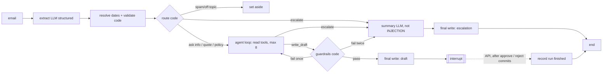

# SPEC: Reservations inbox agent (v1)

Status: agreed in design grilling, 2026-11-12. Supersedes `docs/BRIEF.md` where they differ (languages, time, budget, MCP scope).
All hotel, guest and owner data is fictional.

## Goal
An agent that drafts replies to guest emails for **Hotel Anemos** (14 rooms, fictional Cycladic island of **Psymithos**, owner George).
Code computes prices and availability; the model reads emails, picks tools and writes wording; the owner approves before anything is held or sent.
Secondary goal: a portfolio project showing agent design, guardrails, human-in-the-loop and honest evaluation.

## Users
One user, the owner, works through an overnight batch of 20–40 emails each morning. Success: inbox cleared in < 30 min, most drafts approved with at most a small edit, escalations clearly separated. Latency per email is secondary to cost.

## Scope
**In v1:** new availability/price requests and policy questions in **EN and EL**; extraction with `DateSpec`; code routing + agent loop on rails; code-rendered quotes; 7 guardrails; escalation with reason codes; approval with transactional holds and simulated outbox; Holds page; checkpoints/resume; audit log + monitoring; policy selection by a model over all policy chunks (vector and hybrid retrieval kept as eval comparisons); MCP server (read-only); ~100-email evaluation; replay demo mode.
**Escalated, not drafted:** changes, cancellations, thread replies, other languages, complaints, discounts, groups, and the rules under *Escalation*.
**Out:** real mailbox, payments, multiple hotels, user accounts, channel managers, hosted always-on demo.
**Cut first if behind at end of week 6:** MCP (wk 9), then replay demo mode (wk 11). *(Q31 default, not explicitly confirmed.)*

## Decisions
| # | Decision | Because |
|---|---|---|
| D1 | Time: 20 h/week × 12 weeks; v1 feature-complete week 8 | Plan to reliable hours; extra hours are buffer |
| D2 | LLM budget **max $10 total**; OpenAI cheapest mini-tier model with structured outputs + tool calling; OpenAI small embedding model; hard usage limit. **Chosen (week 4): `gpt-6-luna`** at $0.10 input / $0.01 cached input / $0.50 output per 1M tokens (standard tier, read 2026-11-15 from developers.openai.com/api/docs/pricing). Extraction settings: `max_output_tokens` 600, reasoning effort `none` (the model refuses `minimal`). **Current prompt: `extraction_v3@c5155ec7`** (week 5: counts the people the guest names, named children as children, a bare "we" not a count; injection only for text addressed to an AI, assistant or "the system"; NOTES), after `extraction_v2@b37c0d57` (canonical holiday names, D68); the model was chosen with `extraction_v1@c4e2a967`. No dated snapshot exists: the model page (read 2026-11-16) lists only the alias `gpt-6-luna` under Snapshots, and the replies report the same name, so the alias can change behind us; compare results across runs with that in mind, and pin a snapshot once one is listed. Smoke run on the 5-email Greek check ×3 (`eval/results/20261115T124522Z-smoke-gpt-6-luna.json`, commit ae40bae): 15 calls, 0 failed or incomplete, every field 100% (`injection_suspected` on all 3 repeats of el-injection-greek), 5/5 cases consistent across repeats, $0.0014 total (about $0.00009 per call; repeats hit the input cache), mean latency 1.96 s. **Regression run with v2** (`eval/results/20261115T140459Z-smoke-gpt-6-luna.json`, commit 29cdf29, same set ×3, same pass bar): 15 calls, 0 failed or incomplete, `injection_suspected` 3/3, $0.0014, mean latency 2.04 s. **Raw result:** every field 100% except `rooms` 14/15; el-approximate-late-june was inconsistent across repeats (`rooms` null once, 1 twice), so 4/5 cases consistent. The email asks about "a standard double" with no number, and null is read as one room (D5), so all three answers give the same draft. **The scorer was changed after this run** to compare `rooms` after the D5 default (null → 1), in the score and in the repeat check, because that is what affects the draft (as `stay` is compared after resolving). **Re-scored** with that scorer from the recorded outputs, no new calls (`…gpt-6-luna.rescored.json`): every field 100%, 5/5 consistent: passes. **v3 runs** (commit cb7f0e3, pass bar in NOTES set before them): dev extraction eval (`eval/results/20261116T163544Z-extraction-dev-gpt-6-luna.json`, 40 cases): 0 failed, effective stay / adults / child_ages 100%, route accuracy 97%, escalation recall 100%, precision 90%, no case worse than v2, $0.0034; smoke ×3 (`eval/results/20261116T163800Z-smoke-gpt-6-luna.json`): every field 100%, `injection_suspected` 3/3, 5/5 consistent, $0.0012: passes. **Embeddings (week 5): `text-embedding-3-small`** at $0.02 per 1M input tokens (no cached or output price; read 2026-11-16 from the same page); its model page lists only the alias, as for gpt-6-luna. **1536 dimensions** (the default, which `policy_chunks.embedding` assumes) confirmed on the first real call, 2026-11-16: 27 chunks, 23 µ$ (about $0.00002); since D15's change (week 5) embeddings serve only the retrieval eval's comparison modes. **Policy selector (D15):** `gpt-6-luna`, prompt `policy_select_v2` (v1 was the text of the retrieval eval's baseline `retrieval_baseline_v1`; v2 asks for only the ids needed to answer, never more than 3, and its schema sets `maxItems` 3; NOTES), `max_output_tokens` 100, reasoning effort `none`; the instructions and every chunk come before the query, so they are a cached prefix. **Agent loop (D11), set in week 5 when tool calling was added:** **current prompt `agent_v2@192e4031`** (week 6: no `check_availability`; the redraft and the loop's `DRAFT_REFUSED` answer, D76; policy numbers may be copied exactly, D78; `{{REQUEST_SUMMARY}}` on ask_info whenever the guest gave dates, D80; the words guardrail 5 refuses, in English and Greek; NOTES), after `agent_v1@73d26941`; each version's hash covers the tool lists it is sent with, so v1 keeps its own (NOTES), `gpt-6-luna`, reasoning effort `none`, `max_output_tokens` **2,000** (`AGENT_MAX_OUTPUT_TOKENS`): the model writes only the prose around the placeholders; a long Greek reply (~300 words, estimated at 2–3 tokens a word, not measured) is ~900 tokens, ~1,000 with JSON escaping and the other arguments, so 2,000 doubles it; worst-case output $0.001 per turn (reserved, not spent). A reply cut off at the limit is a typed error (`ReplyCutOff`), never a draft; the agent eval measures real output tokens. Strict function tools, `tool_choice` required, no parallel calls, `store=False`, the whole transcript resent every turn (no `previous_response_id`), so earlier turns are a cached prefix | Minimal spend; credits on hand. gpt-6-luna is the cheapest current (not deprecated) model with structured outputs and tool calling, and it met a pass bar set before the run (no failed calls, injection caught every time, all cases consistent, no field below 100% beyond one explainable miss); the other candidates (gpt-5.6-luna, gpt-5.4-mini) were not run |
| D3 | All model calls behind an own **LLM adapter** (plain `openai` SDK) | Model/provider swappable by config; evaluation can compare |
| D4 | Mailbox behind an **adapter** (fake only in v1); emails stored with real-email fields; idempotent on `message_id`; sending via **outbox** table | Real mailbox in v2 is an add-on, not a rewrite |
| D5 | Input = plain-text `clean_body`, one language, one stay, ≤ 2 rooms (same dates), children with ages. **Greeklish** (Greek in Latin letters) is handled: extraction returns `language: el`, `script: latin`; reply in Greek script | Realistic hard cases; Greeklish is common for a Greek hotel |
| D6 | Model emits `DateSpec` (exact / relative / holiday / approximate + nights); **code** does all calendar maths (years, weekends Fri→Sun, Orthodox Easter, nights → check-out). Holiday `DateSpec` carries `tradition: orthodox / western / unspecified` as written by the guest; house rule in code: `unspecified` → Orthodox, and `{{REQUEST_SUMMARY}}` shows the resolved dates so the guest can correct them | Model handles language, code handles the calendar |
| D7 | Approximate period + length → window (early 1–10, mid 11–20, late 21–end; Easter ±3 d), stay must start in window, ≤ 3 options ≥ 2 days apart, earliest first. Without length → ask for info. A whole month ("sometime in June") → `NEEDS_INFO` in v1. **Min-stay fallback:** if no stay of the requested length fits *only because of the minimum stay* (e.g. mid-August, 3 nights asked, 5 required), offer the options at the min-stay length, marked as a changed length with reason `MIN_STAY`; never if the requested length fits somewhere in the window or nights are closed. Window options are never held (D9) | Real options, no invented numbers |
| D8 | Code renders `{{QUOTE_BLOCK}}` (prices), `{{REQUEST_SUMMARY}}` (dates, guests, rooms) and, in a `CLOSED` decline, `{{OPEN_SEASON}}` (first to last open night of the year asked, D62); hold expiry into `{{HOLD_UNTIL}}` at approval. The model should write no digits outside these | Guardrails check blocks, not numbers in free text |
| D9 | Hold (48 h) **only if the quote matches exactly what the guest asked**; any substitution/options → no hold | Never block rooms the guest didn't request |
| D10 | Approval = one DB transaction: lock draft (`FOR UPDATE`) → flip holds past `expires_at` to `expired` → re-validate (always, any age) → holds → outbox → audit → `approved`. The approval stays in the API; after it commits, the API resumes the run's graph (`thread_id` = email id, D75) only to record the run finished. Double approve → 409; edited-price warnings → 422 unless `confirm_warnings` | DB is the source of truth; no double booking or double send |
| D11 | Graph **C, agent on rails**: code routes; one agent loop (read tools + `write_draft`/`escalate`), built as two graph nodes (agent turn ↔ tool call) with its counters in the graph state (D75), **max 8 tool calls, counting the final `write_draft` or `escalate` and every `write_draft` that failed the checks (D76)**; Q14 rules enforced **inside tools**; model may escalate, never un-escalate. **Tools per route** (D70): `quote` / `ask_info` / `decline` get `quote_price`, `suggest_alternatives`, `search_policies`, `write_draft`, `escalate` (`check_availability` removed with `agent_v2`, week 6: the dev agent eval never called it, and `quote_price` checks availability itself, D59; the function stays for the MCP read tools, D16); `policy` gets `search_policies`, `write_draft`, `escalate`; kind `other` gets `escalate` only. **Code binds the run's request:** `quote_price`, `suggest_alternatives` and `check_availability` take no request id and no dates from the model; `check_availability` checks the stored request's resolved stay and refuses a window or holiday request (`quote_price` lists its options). **`escalate(reason_code, note)`** accepts only the codes that need model judgement: `COMPLAINT`, `DISCOUNT`, `CHANGE`, `CANCELLATION`, `NO_POLICY`, `MODEL`; codes raised by code are not in its enum. An unknown tool or invalid arguments come back to the model as a typed error and count as a call; 8 calls without `write_draft` or `escalate` → `LOOP_LIMIT` | Real tool choice; money rules enforced by construction. The model cannot swap the request it prices, cannot compute a date for a tool (D6), and cannot claim a reason that code decides |
| D12 | Write tools (`hold_room`, `send_reply`) are never given to the model | Prompt injection can't call what isn't there |
| D13 | Infants < 2 in a cot don't count toward occupancy; everyone else does | Single clear capacity rule |
| D14 | Money in integer cents; deposit = ceil(30% of accommodation subtotal) to whole euro, integer-only; city tax separate, paid on arrival, not in deposit | Hand-checkable oracle, no float errors |
| D15 | Policies in English Markdown, 27 heading chunks with stable `policy_id`. **`search_policies` is a model selector** (changed in week 5): the agent writes a query **in English**; one `gpt-6-luna` structured call (D2) gets every packaged chunk and the query and answers up to 3 ids from an **enum of the real ids** (it cannot invent one); an empty list is `NO_MATCH` → escalate `NO_POLICY` (D73). **Evidence** (retrieval eval, dev, `eval/results/20261116T143544Z-retrieval-dev-gpt-6-luna.json`, rules fixed before the run): recall@3 / NO_MATCH recall: all chunks in the prompt 100% / 100%, vector only 94% / 80%, hybrid (pgvector + Postgres full text, RRF) 70% / 80%; hybrid was worse than vector only by 8 queries to 0 (the ORed full-text list without IDF adds noise RRF weighs like the vector list), and the three near-misses vector let through (car hire, ferry tickets, room service) were all caught by the selector. It has no fitted parameter (no threshold), and at 27 chunks retrieval's scale argument does not apply. **Kept as eval modes:** the vector, full-text and hybrid code (`anemos.policies.ranking`, never imported by production code), `policy_chunks` and the embeddings (exact search, the embedding model stored per chunk), so the comparison can be rerun. Reconsider if the policies grow until the cached prefix is no longer cheap | Answers measured against the alternatives on labelled queries; no number to tune |
| D16 | MCP: tools first as plain functions in `reservations/`; in wk 9 a thin MCP server exposes **read tools + resources only**, runs under a **read-only DB role** (SELECT + INSERT quotes); agent becomes its own MCP client | Reuse + career signal + a real permission boundary |
| D17 | One run per email (`thread_id = email_id`), LangGraph checkpoints in Postgres (`langgraph-checkpoint-postgres`, its own connection; D75); the graph stops at `interrupt()` after the draft is stored and is resumed only to record the run finished; unanswered 72 h → Expired; newer email from same guest → older draft *superseded*; no auto-send or auto-escalate, ever; resume in-flight runs on startup | A waiting draft is a proposal, not a promise |
| D18 | Local-first: Docker Compose runs **only Postgres** (pgvector image) until wk 11, then all services; `DEMO_MODE=replay` shows stored runs with no API key; optional manual Azure workflow | $0 hosting; one-command repo for reviewers |
| D19 | Shared owner password (env var + session cookie); `actor = owner` in audit. Until the password exists (week 7) every API route depends on a `require_owner` hook that lets every request through, so **the API is never deployed or bound to anything but 127.0.0.1 before week 7**; `python -m anemos.api` binds 127.0.0.1 only | Public URL can't approve holds; no user table |
| D20 | Code uses an injected clock, never `datetime.now()` | Deterministic tests and evaluations |
| D21 | Test world = **season 2027**: season periods and min-stay rows seeded for 2027, rates per season; test `received_at` between Nov 2026 and Sep 2027; a date without a year resolves to the next future occurrence | The first season the agent would quote; reproducible evaluations |
| D22 | Expired holds never block: availability queries treat `hold` with `expires_at < now` as free (filter, no write); approval flips them (D10); the periodic job only tidies | Read tools stay read-only; correct from week 3 |
| D23 | Timestamps stored as `timestamptz` in **UTC**; the clock (D20) returns timezone-aware UTC; calendar logic (stay dates, < 48 h notice, check-in by 22:00, "next weekend", hold expiry shown to guests) uses hotel time **`Europe/Athens`** | One unambiguous storage format; guests and owner think in hotel local time |
| D24 | **Accommodation subtotal** = room nights + extra beds; city tax excluded. The deposit (D14) is 30% of it, rounded up to a whole euro | "Accommodation" is everything the hotel charges for the stay itself; city tax is collected on arrival |
| D25 | **Extra-bed payers:** leave out infants < 2 (D13), sort the rest by age, oldest first; the first `standard_occupancy` guests fill the standard places, every other guest pays the extra-bed rate for their own age. **Several rooms:** standard places = rooms × `standard_occupancy`, and the ordering runs over the whole party, not room by room (pricing-examples Ex 12) | One deterministic rule; the youngest guests are the extra ones, the cheaper result for the guest |
| D26 | **Free-cancellation period** (14 d, or 30 d in High) is decided by the **arrival date's** season, even if later nights fall in High | Same principle as minimum stay, which also goes by arrival date |
| D27 | **Over capacity:** first a single room of the smallest type that fits everyone; only if no single type fits, split across 2 rooms **of the same type** (the smallest type that fits; mixed types: Later) | One room keeps a party together and is one booking; the cheaper 2-room option is not offered first, the owner can still propose it |
| D28 | **Holidays:** v1 knows **Easter only**. A holiday `DateSpec` resolves to the Easter ±3 d window and follows D7 (stay starts in the window; without length → ask). Any other holiday → `NEEDS_INFO` (ask the guest for dates). Without a year: the first Easter whose window has not ended. Check-in dates before today (hotel date of `received_at`) are cut from the window. The reply must restate the resolved dates in full (guardrail 3) | Easter is the one moving holiday that matters to a Greek hotel; guessing other holidays would invent dates |
| D29 | **Weekends** (hotel date of `received_at`, D23): a weekend stay is check-in Friday, check-out Sunday (2 nights). "Next weekend" = the coming Friday; if received Fri–Sun, the Friday after. "This weekend" = the Friday of the current Mon–Sun week; if received Fri–Sun that arrival is always `SHORT_NOTICE` (D31). A weekend with a stated night count other than 2 → `NEEDS_INFO`. *Known limitation:* a Greek guest may mean "Saturday night only" by a weekend; without a stated count it still resolves to Fri→Sun, and only `{{REQUEST_SUMMARY}}` lets the guest correct it. *Known limitation:* received Mon–Thu, "this weekend" and "next weekend" resolve to the same Friday, although a guest may mean the weekend after by "next weekend"; again only `{{REQUEST_SUMMARY}}` corrects it. The reply must restate the resolved dates in full (guardrail 3) | One fixed reading per phrase; the guest sees the resolved dates in `{{REQUEST_SUMMARY}}` and can correct them |
| D30 | **Year inference** (D21): "next future occurrence" includes today's hotel date | A same-day request is real; `SHORT_NOTICE` (D31) escalates it |
| D31 | **`SHORT_NOTICE`:** less than 48 real hours from `received_at` to **15:00 Europe/Athens on the arrival date** (the check-in time). Exactly 48 h is not short notice. Computed in UTC, so DST changes count real hours (e.g. arrival 31 Oct 2027 → cut-off 29 Oct 16:00 Athens). **`GROUP`:** 3+ rooms | Real elapsed time is what the owner needs to prepare; wall-clock arithmetic is off by an hour around DST |
| D32 | **An adult in every room:** any room plan or request needs adults ≥ rooms (children of any age are not adults). Otherwise no plan and escalate `UNACCOMPANIED_CHILDREN`; this includes a children-only party. Checked after `GROUP` (no fit in 2 rooms wins) | Unaccompanied minors are a legal and safety question for the owner, not for a template |
| D33 | **Accessibility need** (extraction flag `accessibility_need`): only the Accessible type is offered, as one room. If the party does not fit it (head count > 2, D13), escalate `ACCESSIBILITY` instead of substituting a bigger room. Without a stated need the Accessible room is not offered by the plan; offering it when nothing else is free is availability (week 3) | A bigger non-accessible room would not meet the need; the owner knows what else could work |
| D34 | **Open part is re-checked:** a stay trimmed to its open nights (partly closed, Ex 7) is checked again like any stay (`CLOSED`, then `MIN_STAY` by its own arrival date). A too-short open part gets `MIN_STAY(n)` and follows the normal min-stay handling, whose result is checked again too | No rule skips the calendar check; trimming can shorten a stay below its minimum |
| D35 | **Exact dates** (D21, D30): (1) an explicit year is kept even if the date has passed; `SHORT_NOTICE` (D31) then escalates. (2) A check-out and a night count that disagree → `NEEDS_INFO`. (3) 29 Feb without a year → the next leap year (an unseeded year then escalates `NO_CALENDAR`, D36). A check-out without a year is its first occurrence on or after check-in (28 Dec–3 Jan crosses the year) | Never silently rewrite what the guest wrote; ask when two stated facts conflict |
| D36 | **No calendar for a year:** a stay with any night in a year that has no season periods at all is not `CLOSED`; escalate `NO_CALENDAR`. `CLOSED` is only for nights outside the periods of a year that has some. Checked before `CLOSED` | Before the owner sets up a season, "we are closed" would be a false statement to the guest |
| D37 | **Ambiguous day/month order:** the model marks a written date like 03/04 as `ambiguous_order`; code returns `NEEDS_INFO` only if both readings are real and differ (day and month both 1–12, day ≠ month). Otherwise the flag is ignored (13/04, 04/04) | The model notices the ambiguity, code decides it; no guessing between 3 April and 4 March |
| D38 | **Room choice:** when several rooms of the chosen type are free for the whole stay, the hold takes the **lowest room number** (for 2 rooms: the two lowest). Availability (`free_rooms`) is a snapshot; approval re-validates before holding (D10) | Deterministic and testable; the owner can still move guests between rooms |
| D39 | **Template policy sentences agree with the policies:** the quote templates state policy facts (breakfast included, first night charged after the free-cancellation date, 30% deposit, 48 h deposit deadline for held quotes). Each must agree with the policy documents (D15); a test checks them once the policy chunks exist | Two sources for one policy can drift; the guest must not get a template that contradicts the policy text |
| D40 | **Reject** (states Q1): the draft becomes `rejected`, the email `closed`; nothing more happens in the system and the owner replies by hand. "Reject with feedback, get a new draft": Later | A redraft loop driven by owner feedback is a feature of its own; v1 keeps one draft per email |
| D41 | **Owner edits** (states Q2): every text version is kept with its author (`agent` / `owner`); the **latest** version is sent | The audit trail must show what the agent proposed and what the owner changed |
| D42 | **Draft expiry** (states Q3): after 72 h with no owner action the draft becomes `expired` and the email `expired`, shown in its own list; the owner can only close it. It is **not** escalated | D17: nothing is escalated automatically |
| D43 | **Confirming a hold** (states Q4): the owner clicks "deposit received" on the Holds page; `hold` → `confirmed` | Without payments this is the only way `confirmed` is ever used |
| D44 | **Re-validation fails at approval** (states Q5): the draft becomes `invalidated`, the email `escalated` with `NO_LONGER_AVAILABLE`; nothing is held or sent; the owner replies by hand. Re-running the agent for a fresh offer: Later | It follows an owner action, not the passing of time, so D17 holds |
| D45 | **No draft after escalation** (states Q6): `escalated` goes only to `closed` | One run per email (D17) |
| D46 | **Cancelling a hold** (states Q7): only the owner, on the Holds page. A guest's cancellation email is escalated (`CANCELLATION`) and the owner cancels by hand | Changes and cancellations are escalated in v1 (Scope) |
| D47 | **What re-validation checks** (D10): everything the draft states. Every quoted price still matches a fresh price from the database, and every offered option, held or not (min-stay version, alternatives, window options), is still available. Any failure → D44 | The guest must not receive an offer that is already false when it is sent |
| D48 | **Same guest = same `from_address`** (D17). A newer email from that address supersedes a `pending_approval` draft. A draft created when a newer email from that address already exists is **born superseded**. **"Newer"** = later `received_at`; equal `received_at` → the higher `id` (stored later) is newer. An email stored late with an older `received_at` supersedes nothing and its own draft is born superseded | One stable key; `in_reply_to` is a thread reply, which is escalated anyway (`THREAD_REPLY`). `received_at` is when the guest wrote, so a batch fetched out of order cannot make an older email win; `id` makes the order total |
| D49 | **Reason codes added:** `NO_LONGER_AVAILABLE` (re-validation failed at approval, D44), `OWNER_REOPENED` (owner says a set-aside email was not spam), `SYSTEM_ERROR` (an unexpected error while processing) | Every way into `escalated` in `docs/states.md` has a code |
| D50 | **Set-aside emails** are visible through an inbox filter, so a wrongly filtered email can be found and reopened (`OWNER_REOPENED`) | A spam filter with no way to look at what it removed hides its mistakes |
| D51 | **Final statuses are enforced in the database:** a trigger on `emails`, `drafts`, `bookings` and `outbox` refuses any UPDATE or DELETE of a row whose status is final (`docs/states.md`), and any change to `outbox` text (recipient, subject, body). **`quotes`, `draft_versions`, `draft_offers` and `audit_log` are write-once:** no UPDATE, no DELETE. The final statuses in the triggers are tested against `anemos.states` so they cannot drift. Allowed transitions between non-final statuses are enforced in code and tests, not in SQL | The rule that matters most (nothing un-finalises, nothing rewrites a sent text or what the agent proposed) holds even against a bug or a manual SQL edit; the full transition table in SQL would duplicate `docs/states.md` |
| D52 | **Two approvals racing for the same room:** neither sees the other's uncommitted hold, so both can pass re-validation (D47). (1) **Room locks first:** before inserting holds, the approval takes a per-room advisory lock (`pg_advisory_xact_lock(1, room_id)`) for each room, in ascending room number (D38); the second approval waits there until the first commits. (2) **Remaining conflict → D44:** the hold inserts run in a **savepoint**; an exclusion violation (the room was taken meanwhile) rolls back only the savepoint and becomes D44's invalidation (`invalidated`, email `escalated` with `NO_LONGER_AVAILABLE`). (3) **The exclusion constraint stays the final guard:** the locks only order the inserts; the database still refuses any overlapping active booking | No global approval lock; the races are tested with two connections, repeated. The room lock is needed because an exclusion constraint checks after inserting, so two simultaneous inserts on the same room deadlock (found by the repeated 2-room race test); with the lock, the second insert fails cleanly instead. Ascending order keeps multi-room approvals deadlock-free |
| D53 | **Guardrails 1 and 7 from week 3:** stub drafts are checked for `{{QUOTE_BLOCK}}` exactly once on the quote route and `proposed_holds` ⊆ the run's quotes satisfying D9; the other guardrails come in week 6 | "Every draft is checked in code before it is shown" holds from the first draft |
| D54 | **Approving an expired draft** (> 72 h, D42): the draft and email are flipped to `expired` and committed; the response is **409** with `expired` in the body | Same code as a double approval: the draft is no longer `pending_approval`; the body tells the owner why |
| D55 | **No room type named:** offer the smallest type (lowest max occupancy, D27 ordering) that fits the party in the number of rooms the guest asked for, never the Accessible room without a stated need (D33); if none fits, the D27 plan. Any type counts as "what was asked", so an exact fit may be held (D9) | The D27 ordering applied to the guest's own room count; consistent with `hold_allowed` ("any type if none was named") |
| D56 | **Accessibility need with 2 rooms requested:** escalate `ACCESSIBILITY` | There is one Accessible room; D33 escalates rather than substitutes a room that does not meet the need |
| D57 | **Min-stay version reaching closed nights:** if a stay (or its open part, D34) is shorter than its minimum and the min-stay version includes closed nights, there is no offer; the result is `MIN_STAY_CLOSED` with the minimum (n nights) and the closed nights, so the reply can say both. Not plain `CLOSED` | The nights the guest asked for may all be open; "we are closed" would be untrue. Cannot happen with the 2027 seed (1-night minimum at opening and closing), only if season data changes |
| D58 | **Every `quote_price` call stores a new quote**; quotes are never reused or updated (write-once, D51). A draft offers exactly the quotes linked in `draft_offers`; a quote no draft links stays as the record of what was priced, and when | A quote is a priced snapshot with its own `created_at`: reusing one would need a lookup key and could return a price from before a rate change; extra rows are cheap and bounded by the 8-call loop limit (D11), and guardrail 7 plus the one-hold index keep a draft from offering or holding the wrong one |
| D59 | **`quote_price` checks availability** for the plan `build_offer` chose (a D27 substitute, not the type asked): too few free rooms for the whole stay → `FULLY_BOOKED(room_type, rooms_needed, rooms_free)`, nothing stored, next step `suggest_alternatives`. One shared function (`rooms_for_plan`: the lowest free room numbers, D38, or `FULLY_BOOKED`) is the only definition of "available", used by `quote_price`, `suggest_alternatives` and approval's re-validation (D47). Expired holds count as free (D22); the Accessible-room fallback (D33) belongs to `suggest_alternatives` | D11: rules inside tools, so the model cannot offer a full room type even if it skips `check_availability`; one definition keeps the three callers from disagreeing. Still a snapshot: approval re-checks, and the exclusion constraint is final |
| D60 | **`suggest_alternatives`** (spec Unmet requests), for the offer `build_offer` would make: if that plan is free → `ORIGINAL_AVAILABLE`, nothing stored. Else (1) **other room types** for the same stay that the party fits in the same number of rooms and that are free (D59), at most 2, cheapest first by accommodation subtotal (D24; tie: type id); the Accessible room only if no other type is free (D33); skipped for an accessibility need. (2) **Only if no other type is free: other dates**: the same type and rooms on same-length stays shifted 1–7 days, nearest first, earlier first on a tie, at most 2; a shifted stay must pass the calendar unchanged (no trimming or lengthening) and not be `SHORT_NOTICE` (D31, which also excludes the past). (3) Else `NONE_FOUND`. Each option is stored as a quote whose `changes` add `other_type`/`more_rooms` (against the guest's request, D55) or `other_dates` to the offer's own calendar changes | The spec's "≤ 2 alternatives cheapest first · all booked → nearest same-length ranges ±7 d, else decline" made deterministic and testable; one definition of "free" (D59); an alternative never silently changes the length |
| D61 | **Per-sender lock for D48:** storing an email and creating a draft both take `pg_advisory_xact_lock(hashtextextended(from_address, 0))` first, held until commit; so superseding and "born superseded" run one after another for one address. Other senders never wait (except on a hash collision, then only for the other transaction's few milliseconds) | Under READ COMMITTED neither path sees the other's uncommitted row, and the rule spans two tables with no shared row to `FOR UPDATE`; without the lock a draft could stay pending although a newer email exists |
| D62 | **Decline route:** a reply that offers nothing (`CLOSED`: every night closed; `NONE_FOUND`: nothing free, D60) is a draft on route `decline`: no `{{QUOTE_BLOCK}}` (guardrail 1), `{{REQUEST_SUMMARY}}` present (guardrail 3), no offers. A `CLOSED` decline names the open season of the year asked (first to last open night) through the code-rendered `{{OPEN_SEASON}}` block (D8), so the model writes no dates. `MIN_STAY_CLOSED` and `NO_RATE` still escalate (`MODEL`, `SYSTEM_ERROR`), decided by code. A room freed between two tool calls (`ORIGINAL_AVAILABLE` after `FULLY_BOOKED`) goes back to the agent, which calls `quote_price` again (the stub drafter, which has no model, escalates it `MODEL`). **Notes:** a quote block shows one note line per entry in the quote's `changes`, in a fixed order (open part, min stay, room type (capacity, D27, or availability, D60), more rooms, other dates, window option) | A decline is a normal, useful answer (the guest learns when to come back), not an owner case; quoting rules (guardrail 1) must not apply to a reply with no price. One line per change keeps every substitution visible to the guest |
| D63 | **Price check on owner edits:** each offer stores its rendered quote block at draft creation (`draft_offers.rendered_block`, write-once). An owner edit is always stored, and passes the price check only if every block appears verbatim in the new text; otherwise the version's guardrail result `price_check` holds the edited-price warning, and approval refuses that version unless `confirm_warnings` (D10, 422). Expiry triggered by an owner action is audited twice: `draft.expired` (actor `system`) and `draft.action_refused` (actor `owner`) | Re-rendering from the stored quote would have to reproduce the text byte for byte, and any later change to templates or room names would raise false warnings; the stored block is exactly what the agent proposed. Any edit inside a block (even wording) warns: the owner confirms once |
| D64 | **Arrival passed at approval:** re-validation (D47) also invalidates an offer whose check-in moment (15:00 Europe/Athens on the arrival date, as in D31) is before the approval time; exactly at that moment is still valid. Reason code `NO_LONGER_AVAILABLE` (D44), with the cause "check-in … has passed" in the invalidation reasons and audit | The owner's next step is the same as for any failed re-validation (reply by hand), so no new code; the detail says why. Without it, an email answered 50 h ahead and approved 60 h later would hold a room for a stay that has already begun |
| D65 | **Runs do not hold the database while waiting for a model (from week 4, when extraction makes the first model call):** a run commits `received` → `processing` in its own short transaction, then calls the model with no transaction open and no advisory lock (D61) held. The final write (draft, version 1, offers, and the email's next status, or the escalation) is one short transaction that takes D61's sender lock first and checks the email is still `processing` and no newer email has arrived (born superseded, D48). **If the email is no longer `processing`**, the final write writes nothing and rolls back, and an audit entry recording the discarded run is written in its own short transaction afterwards | A model call takes seconds; holding a row or sender lock that long would block storing the guest's next email, owner actions and approvals for that sender, and a crashed run would hold them until its connection dies. `processing` committed early is also what lets resume (week 10) find runs in flight. The audit entry keeps a discarded run visible instead of silently lost |
| D66 | **Sending (step 15):** every outbox row has a stable Message-ID (`<outbox-{id}@anemos.invalid>`), given to the transport on every attempt, with `In-Reply-To` and `References` set to the guest's Message-ID so the reply threads. v1: one transaction per message, the row claimed with `FOR UPDATE SKIP LOCKED` and locked during the send; a failure of any kind is a failed attempt (attempts + 1, `last_error`, `next_attempt_at` = now + 1, 2, 4 … minutes, max 60), with no maximum (`failed` status: Later). **v2 replaces the row lock with a lease** (e.g. `claimed_until`): claim and commit, send with no transaction open, then record the result in a second short transaction (D65's rule: no transaction across a slow outside call). **v2 closes the crash window** between sending and marking sent: before retrying a row whose last attempt has no recorded result, the sender looks for its Message-ID in the mailbox's Sent folder and marks it sent if found. This depends on the lease: "no recorded result" can only be known if the attempt's start is committed before the send | A stable Message-ID makes a real send checkable, so a retry never sends a second copy; the v1 row lock is simple and correct while sending is simulated, but would hold a database lock across a network call once the mailbox is real |
| D67 | **Approve and edit name the version the owner saw.** `approve_draft(…, version=n)` and `edit_draft(…, base_version=n)` take the version number shown on the owner's screen. Inside the transaction, after `lock_pending_draft` has locked the draft row, if `n` is not the latest version the action is refused with `StaleVersion(seen=n, latest=m)`: nothing written; the API answers **409** `{"error": "stale_version", "latest": m}`. Order of checks: refused / expired (D54) first, then stale version, then the price check (D63). A `draft.action_refused` audit row (`{"reason": "stale_version", "seen": n, "latest": m}`) is written in its own transaction, as for `TransitionRefused` | Over HTTP the latest version can differ from the one on screen (phone shows v1, laptop saved v2): approving would send text nobody approved, editing from v1 would silently drop v2. The check runs under the draft's row lock, so no edit can slip in between check and write |
| D68 | **Holidays outside the season:** besides Easter, code knows a short table of fixed-date holidays: Christmas (24–26 Dec) and New Year (31 Dec–1 Jan). Without a year, the holiday is its next occurrence that has not ended (as for Easter, D28). If every day of the holiday is outside the open season of a year that has a calendar, the request is `CLOSED` and gets the decline reply with that year's open season (D62), without asking for dates; a year with no calendar is `NO_CALENDAR` first (D36). A fixed-date holiday inside the season, and every other holiday, stays `NEEDS_INFO` (D28); 15 August (Δεκαπενταύγουστος) is deliberately one of these in v1. Implemented in week 4 with extraction. **Readings:** New Year's Eve and New Year's Day are both `new_year`, and its year is the year of 1 January ("New Year 2028" and "New Year's Eve 2027" are both 31 Dec 2027 – 1 Jan 2028). Extraction writes canonical holiday names (`easter`, `christmas`, `new_year`; prompt `extraction_v2`) and code matches them exactly: any other name is `NEEDS_INFO`, so an unexpected spelling asks for dates instead of being guessed | Asking for exact dates only to answer "we are closed" wastes a round trip; fixed dates are facts, not guesses, so D28's reason ("guessing would invent dates") does not apply |
| D69 | **Late arrival:** check-in is 15:00–22:00 hotel time. An arrival time (extraction `arrival_time`) from 22:01 to 05:59 is `LATE_ARRIVAL` (escalate); 00:00–05:59 counts as after midnight, not early. Exactly 22:00 is on time. No arrival time stated: not late | Check-in ends at 22:00, and an arrival after midnight is the latest case, not the earliest; comparing clock times naively would call 00:30 early |
| D70 | **Routing in code** (`anemos.routing.route`, pure, before any agent): the first rule that matches decides, in this order: thread reply (`THREAD_REPLY`, before extraction) → `INJECTION` → spam (set aside) → language not EN/EL (`LANGUAGE`) → flags (`LEGAL`, `BILLING`, `MEDICAL`; all present go into one escalation) → kind `question` → the agent on route `policy`; kind `other` → the agent with only `escalate` (it picks the code: `COMPLAINT`, `CHANGE`, `CANCELLATION` …; D11) → `NO_CALENDAR` → `CLOSED` (decline, D62) → `SHORT_NOTICE` → `GROUP` → `UNACCOMPANIED_CHILDREN` → `ACCESSIBILITY` → `LATE_ARRIVAL` → `ask_info` if anything is missing, else `quote`. **A rule whose input is missing is skipped, not failed:** without dates the calendar rules are skipped, without a complete party the room-plan part of `GROUP`; the missing input ends in `ask_info`, but a rule that can be decided without it still applies (5 rooms and no dates is `GROUP`; no adults is `UNACCOMPANIED_CHILDREN` even without the children's ages). **Windows** (Easter, part of a month; D7, D28): `NO_CALENDAR` if any night of any stay the window allows (first check-in up to last check-in + nights) is in a year with no season periods; `CLOSED` only if every one of those nights is closed, and a partly closed window goes on to quote; `SHORT_NOTICE` applies to a single stay, and window options skip short-notice check-ins. Availability is not routing: a request the router sends to `quote` can still end as a decline (`NONE_FOUND`, D60) | Rules that need no judgement are decided once, in code, in a fixed and tested order. Asking for a missing fact must not hide an escalation that is already certain. A window is only "closed" when no stay in it could be offered |
| D71 | **A run on an agent route has three phases** (D65 applied to the loop). (1) One short transaction stores the extraction, the request row and the routing decision, and commits; the email stays `processing`. (2) The agent loop runs with no transaction open and no lock held; each tool call runs in its own short transaction on its own connection and reads the committed request; quotes it stores are committed (write-once, D58; a quote no draft links stays as the record). (3) One short final transaction takes the sender lock (D61), checks the email is still `processing` and no newer email has arrived (born superseded, D48), and writes the draft or the escalation. **Emails escalated or set aside by code** make no model call after extraction and keep a single final transaction. **A crash during the loop** leaves the email `processing` until resume finds it (week 10). **With the graph (D75, week 6):** the checkpointer writes on its own autocommit connection, never inside a run transaction, and holds no lock on our tables; the three phases are unchanged. **Escalations that get a summary (D81)** also follow the three phases: (1) commits extraction, request and routing, (2) the summary call with no transaction open, (3) the final transaction writes the escalation with its summary. Set-aside emails and escalations without a summary (`INJECTION`) keep a single final transaction | Up to 8 model calls take tens of seconds; holding the sender lock or a transaction that long would block the guest's next email, owner actions and approvals. Trade-off: the draft is no longer written against hotel data read in the same transaction as the final write; approval re-validates every offer anyway (D47) |
| D72 | **Code decides the draft's route and hold, not the model.** `write_draft(text, offer_quote_ids, policy_ids)` has no route and no hold argument. Route, as a pure function of the run: any offer → `quote`; else any `CLOSED` or `NONE_FOUND` in this run → `decline`; else `NEEDS_INFO` → `ask_info`; else the router's route. Hold: exactly one offer and its quote's `hold_allowed` → that offer is held (as the stub drafter does); otherwise none. Guardrail 7 still checks the result | The model cannot choose a route that escapes guardrail 1, or hold a room D9 does not allow; one tested function instead of a judgement |
| D73 | **`NO_MATCH` on any route → escalate `NO_POLICY`**, also on `quote` when the guest asked a policy question beside the request: no reply that leaves the guest's question out | A draft that answers half the email looks complete to a busy owner, and the question would go unanswered |
| D74 | **The agent loop's rules** (D11 applied). **What counts toward 8:** every turn that produced a call: a read tool, a call the adapter rejected (unknown tool, invalid arguments: answered under its own `call_id` with a typed error), a refused call (an invalid query, `check_availability` on a window), and the final `write_draft` or `escalate`; 8 calls without either → `LOOP_LIMIT` (an invalid `write_draft` as the 8th included). **`SYSTEM_ERROR`:** a reply cut off at the output limit (no `call_id` to answer), any other failed turn, the budget refusing a turn, a bug in a tool or in the final write. **Tool results carry no money amount:** the model sees quote ids, room types, rooms, nights and changes, never a price. **The final write** checks the draft before storing it: guardrail 1, **guardrail 6** (every cited `policy_id` was returned by `search_policies` in this run; brought forward from week 6 as D53 brought 1 and 7), guardrail 7, and the placeholders: only `{{QUOTE_BLOCK}}`, `{{REQUEST_SUMMARY}}` and `{{OPEN_SEASON}}`, each renderable in this run (`{{OPEN_SEASON}}` needs a `CLOSED`, `{{REQUEST_SUMMARY}}` a stored request with something known, its dates or its party (D80), the quote route an offer); any failure → `GUARDRAIL_FAIL`. Quote blocks are rendered from the quotes the tools priced in this run. **Where the run's evidence is kept:** one `agent.tool_called` audit row per tool call (for `search_policies`, the returned texts and the `policies.md` hash) and the cited ids in `draft.created`; no migration | The model can neither restate a price nor cite a section it was not given; every ending is typed, so an email never stays `processing` after a run; checks that need only the run's own results run from the first agent draft |
| D75 | **The run is a LangGraph `StateGraph`** (week 6). (1) **Nodes are the existing steps:** extract, route, agent turn, tool call, final write, summary (D81); no step's behaviour changes. (2) **Graph state holds only ids, the transcript (plain JSON values) and the loop counters**, never hotel data, quotes or statuses. (3) **The database is the source of truth** (D51): a node that continues a run (resume, or the step after `interrupt()`) reads the email's status first, and the database wins on any disagreement (a run whose email is no longer `processing` is discarded as in D65). (4) **Checkpointer:** `PostgresSaver` on its own autocommit connection (D71); checkpoints after every node, so a run stopped mid-loop resumes from its last checkpoint without repeating finished model calls. A tool node interrupted after its transaction committed runs again on resume; an extra quote row is harmless (write-once, D58). Its tables are created by `PostgresSaver.setup()`, called from our migrate command (`python -m anemos.db.migrate`, after the Alembic migrations), in their own schema `langgraph`; not SQL copied into an Alembic migration, which would drift on library upgrades. The test harness empties them with the operational tables. The serializer loads no Python class (the state is plain JSON). **A resumed run's evidence** (owner, NOTES 2026-11-17): the `Hit`s are rebuilt from the run's `agent.tool_called` rows only if their `policies.md` hash equals the current one, and each quote is priced again from its row and the request and must equal the stored amounts; otherwise `SYSTEM_ERROR`. A resume reads the email's status first and does nothing unless it is `processing`. **LangSmith tracing is forced off** when the package is imported, whatever the environment says. (5) **Interrupt:** `interrupt()` after the draft is stored (`pending_approval` or born superseded). Every owner action that ends the draft (approve, approve that invalidates, reject) resumes the thread after its transaction commits, only to record the run finished (`run.finished` audit). Resuming is idempotent; a failed resume never fails the owner's action: it is logged and audited (`run.resume_failed`) and the thread stays interrupted for the week-10 tidy-up. An escalated or set-aside run ends without an interrupt. **Supersede and expiry leave threads interrupted**; the week-10 tidy-up ends them | D10 and D17 planned a graph from the start; the statuses and the D71 phases stay as built, so the graph adds checkpoints and resume without a second source of truth |
| D76 | **Redraft:** the checks (guardrails 1–7 and the placeholder check, D74) run in the loop on `write_draft`, before the final write. First failure → the failed checks go back to the model under that call's `call_id` (no rendered block, no price); second failure → `GUARDRAIL_FAIL`. Every `write_draft` counts toward the 8 calls (D11); a first failure on the 8th call is `LOOP_LIMIT` (D74). The final write checks again; a failure there is `GUARDRAIL_FAIL` | One chance to fix a mechanical mistake; the cap on model calls is unchanged |
| D77 | **Guardrails 2–5 on owner edits** check only the text the owner changed against version 1 (a word diff), so no extra rendered block is stored. A failure is a warning in the version's guardrail results, like the price check (D63): approval refuses that version unless `confirm_warnings` (422). Never a block. **One 422 lists every warning of the version** (price and guardrail, the price first), and each one shown is audited (`draft.price_warning_shown`, `draft.guardrail_warning_shown`), so `confirm_warnings` never confirms a warning the owner was not shown. **On edits:** guardrail 2 also allows a number already in version 1 and leaves changed words inside a rendered quote block to the price check; guardrail 3 checks that version 1's summary line, if it had one, is still there word for word; guardrails 4 and 5 read every changed run | The owner is the human in the loop; a warning catches a slip ("confirmed"), a block would stop a legitimate edit |
| D78 | **Guardrail 2's unit:** every number written in the free text (a run of digits with its attached `:` `.` `,` `%`, e.g. `08:00`, `30%`, `48`) must appear in the text of a policy chunk returned by `search_policies` in this run. Free text = the draft with the placeholders (agent) or the changed words (owner, D77) | A Greek reply quotes an English chunk: "48 ώρες" passes on "48 hours"; a number the model computed or invented does not |
| D79 | **Guardrail 4:** EN email → no Greek letter in the free text; EL email (Greek or Greeklish) → at least ⅔ of the letters in the free text are Greek | Names such as Anemos and Wi-Fi stay in Latin letters in a Greek reply; a fixed rule, not fitted to a result |
| D80 | **Guardrail 3:** `{{REQUEST_SUMMARY}}` is required on `quote` and `decline`, and on `ask_info` when the request used a relative or holiday date. It **renders the known part** of an incomplete request (resolved dates without the party, the party without dates, rooms); with nothing known it cannot render and must not be used (placeholder check, D74) | Resolves the conflict between guardrail 3 and D74's placeholder check: an `ask_info` reply to "next weekend, how much?" shows the resolved dates |
| D81 | **Escalation summaries:** every escalation after extraction gets one summary call (`gpt-6-luna`, structured, prompt `escalation_summary_v1`, 2–3 lines **in English whatever the email's language**; input: codes and why, the extraction, the tool results so far, and **the guest's email, escaped inside `<email>`** (owner: COMPLAINT and DISCOUNT cannot be judged from the extraction alone), which the model describes and never obeys), except `INJECTION` (the email text is not sent to a model again), `THREAD_REPLY` (no extraction), a `SYSTEM_ERROR` because extraction failed (owner: nothing to summarise, and the model may be what failed) and the stub path (extraction eval, stub demo). In the graph: `summarise`, then the escalation's final transaction (`write_escalation` for escalations by code, the final write for the agent's); the summary is checkpointed. **Secondary codes:** the summary may add `COMPLAINT` or `DISCOUNT`, never remove a code (D11); the audit records which codes the model added. A failed or refused summary call → escalation without a summary (audited), never `SYSTEM_ERROR` on its own. Stored in `emails.escalation_summary` (migration) | Closes the open item: `el-group-wedding` (GROUP + DISCOUNT) and `el-complaint-legal` (LEGAL + COMPLAINT) get their second code from a call that is made anyway |

## Domain data
| Type | Rooms | Std/max | Extra bed | Notes |
|---|---|---|---|---|
| Standard Double | 6 | 2/2 | cot only | garden view |
| Sea View Double | 4 | 2/3 | 1 extra bed | balcony |
| Family Suite | 3 | 2/4 | sofa beds (persons 3–4 charged as extra beds) | kitchenette |
| Accessible Double | 1 | 2/2 | cot only | step-free, with a step-free shower; offered without stated need only if nothing else fits (owner flag) |

Open 15 Apr–31 Oct. Seasons: Low 15 Apr–31 May & Oct · Mid 1 Jun–14 Jul & Sep · High 15 Jul–31 Aug.
Rates € per room-night (Low/Mid/High): Std 70/95/140 · Sea 95/130/190 · Suite 140/180/260 · Accessible 70/95/140. Each night at its own season.
Min stay by **arrival date**: 1/2/3 nights; 5 for arrivals 10–20 Aug. Extra bed: child 2–11 €20, 12+ €35/night; cot free. City tax €1.50 (Low) / €4.00 (Mid/High) per room-night.
Policies: cancellation free until 14 d (High: 30 d) before arrival, then first night; deposit 30% within 48 h; check-in 15:00–22:00, out 11:00; no pets except assistance dogs; breakfast included for all 08:00–10:30; transfer from the port or the island's airport €25 per trip per car (up to 4).
House facts (week 5, for the policies; one per line):
- Payment: the deposit by bank transfer or card; the rest at the hotel by card or cash.
- Wi-Fi: free in all rooms and public areas.
- Parking: no hotel car park; free public parking 100 m from the hotel.
- Smoking: not allowed indoors or on the balconies; allowed in the garden.
- Luggage: stored free of charge on the day of arrival and of departure.
- Early check-in / late check-out: on request, depending on the day's bookings; confirmed on the day.

Left out of the policies on purpose (`NO_MATCH` → `NO_POLICY`, D73), including near-misses: swimming pool, gym, spa, restaurant / dinner, room service, car or scooter hire.
Unmet requests: other type free → ≤ 2 alternatives cheapest first · all booked → nearest same-length ranges ±7 d, else decline · min stay → quote min-stay version · over capacity → smallest single type that fits; only if none fits, 2 rooms of one type (D27); fewer adults than rooms → escalate (D32); accessibility need not fitting the Accessible room → escalate (D33) · children without ages → ask · 3+ rooms or < 48 h to arrival → escalate · partly closed → offer open part, re-checked like any stay (D34).

## Data model
| Table | Key fields |
|---|---|
| `room_types`, `rooms` | type, name (EN) and `name_el` (EL, migration 0004), std/max occupancy, extra-bed rule; room number |
| `seasons`, `season_periods` | season id (`low/mid/high`), `city_tax_cents`; season, date range. No overlap; a night in no period = closed |
| `room_rates` | type, season, `rate_cents`; one row per type × season, no dates |
| `min_stay_rules` | arrival range, nights; no overlap; dated (the 10–20 Aug rule cuts across High) |
| `extra_bed_rates` | `band` (`child_2_11` / `age_12_plus`), `rate_cents` per extra bed per night; one row per band, same for all seasons and room types. Who pays and the age bounds of each band are code (D25); infants have no row (free cot, D13). Added week 2 (migration 0003) |
| `bookings` | `room_id`, `stay daterange [in,out)`, `status hold/confirmed/cancelled/expired`, `expires_at`, `request_id`, `email_id`, `draft_id` (week 3: must point to an `approved` draft), `price_cents`. **Exclusion constraint** `(room_id WITH =, stay WITH &&)` where status in (hold, confirmed); needs `btree_gist` |
| `requests` | the extracted request of an email (`DateSpec`, resolved dates, guests, rooms), one per email; target of `bookings.request_id` and `quotes.request` |
| `quotes` | request, room type, stay, rooms, nightly lines (JSON), subtotals, city tax, deposit, cancel deadline (no stored total: it is accommodation + city tax); `changes` (set of `open_part / min_stay / other_type / more_rooms / other_dates / window_option`, empty = exactly what was asked) and `hold_allowed`, generated as "`changes` is empty" (D9, the quote's half). Write-once (D51) |
| `emails` | `message_id` (unique), `in_reply_to`, `mail_thread_id` (the mailbox's thread; not D17's `thread_id`), `from_address` (lowercase), `subject`, `raw_body`, `clean_body`, `language`, `received_at`, `created_at` (stored at, injected clock), status, `reason_codes` (escalation) |
| `drafts` | email (unique: one draft per email), request, `route` (`quote/ask_info/policy/decline`, guardrail 1 needs it; `decline` added by migration 0009, D62), status, `created_at` (72 h expiry counts from it), `decided_at` (when it left `pending_approval`) |
| `draft_versions` | draft, version number, author `agent/owner`, text, guardrail results of that text (D41). Write-once (D51) |
| `draft_offers` | draft, quote, `hold` (only if the quote's `hold_allowed`, D9; at most one per draft); `rendered_block` (the quote block exactly as version 1 showed it, migration 0010, D63); replaces `quote_ids` + `proposed_holds` so both are foreign keys. Write-once (D51) |
| `outbox` | draft (unique, must be `approved`), `to_address`, `subject`, final text (the message exactly as sent; never changes, D51), status `pending/sent (simulated)`, attempts, last error, `next_attempt_at` (retry backoff; NULL = due now, migration 0011), `sent_at`. The Message-ID is derived from the id, not stored (D66) |
| `policy_chunks` | `policy_id`, title, text, `text_sha256` (of the embedded text), embedding (`vector`), `embedding_model` (D15), tsvector (generated, `english`); no vector index (exact search, D15). Seed data: **replaced as a whole** on load (from the packaged `policies.md` and `embeddings.json`, by `seed`), so **not write-once**, unlike D51's tables; a run never writes or reads it: only the retrieval eval's comparison modes read it (D15); `search_policies` uses the packaged `policies.md`, and what it returned is kept in the run's own records |
| `audit_log` | write-once (D51): email (= the run, D17), draft, step, event (`area.action`, e.g. `draft.approved`), input/output JSON, model, `prompt_version`, tokens, cost (integer micro-USD), latency, error, actor `owner/agent/system`, at |

Tables are created by migrations in the week they are first needed. Week 1: inventory tables + `bookings`, with `bookings.email_id` and `request_id` as nullable columns without foreign keys. **Week 3 adds the foreign key** for `bookings.email_id` and `request_id` once their target tables exist: one two-column key `(request_id, email_id)` → `requests (id, email_id)`, `MATCH FULL` (both set or both NULL). It replaces two one-column keys, which would never refuse a row it accepts (the request must belong to that email, and `requests.email_id` already points at `emails`).

## Tools
| Tool | Reads/writes | Approval | Errors |
|---|---|---|---|
| `check_availability` | reads (the stored request's stay → free rooms per type; no dates from the model, D11) | no | `INVALID_DATES`, `CLOSED`, `MIN_STAY(n)`; escalation `NO_CALENDAR` (D36) |
| `quote_price` | reads the stored request (dates, party, type: never from the caller); stores a quote (no inventory effect, D58) | no | `FULLY_BOOKED(room_type, rooms_needed, rooms_free)` (D59: the chosen plan is not free; next step `suggest_alternatives`, nothing stored), `NEEDS_INFO` (dates, adults, children's ages), `CLOSED`, `MIN_STAY_CLOSED` (D57), `NO_RATE`; escalations `NO_CALENDAR`, `GROUP`, `ACCESSIBILITY`, `UNACCOMPANIED_CHILDREN`. Over capacity is not an error: the D27 plan is substituted and recorded in the quote's `changes` (the valid alternative). **A window request** (Easter, part of a month; D7, D28) returns up to 3 options inside the window, each stored as a quote with `window_option` (plus `min_stay` for the D7 fallback), never held; with none: `NO_CALENDAR` first, then `CLOSED` (every candidate night closed, or no stay passes the calendar), a party escalation, `NONE_FOUND` (the plan's room type is taken at every check-in: decline naming that type, no other types or dates searched), or `SHORT_NOTICE` (every free check-in too soon). **A fixed-date holiday** (D68) is never priced: `NO_CALENDAR`, `CLOSED`, else `NEEDS_INFO` |
| `suggest_alternatives` | reads the stored request; stores each option as a quote (D58, D60) | no | `ORIGINAL_AVAILABLE` (the plan is free: next step `quote_price`, nothing stored), `NONE_FOUND` (decline); the base offer's `NEEDS_INFO`, `CLOSED`, `MIN_STAY_CLOSED`, `NO_RATE` and escalations, passed through. Not for window or fixed-date holiday requests: the window options are the choice already (D7) and a holiday is never priced (D68), so it refuses both |
| `search_policies` (English query) | reads the packaged `policies.md` (no database, no transaction). In order: (1) checks the query; (2) one selector call through the adapter (budget, one retry, audit with the run's email; D15). Returns up to 3 chunks (`maxItems` 3 in the schema: a reply with more does not parse and is a failed call, never a silent cut); the run stores their text, `text_sha256`, the hash of `policies.md`, the model, `prompt_version` and the ids as returned | no | `NO_MATCH` (the selector returned no id → escalate `NO_POLICY` on any route, D73). A blank, Greek or over-300-character query, or one containing `<` or `>` (it could close the prompt's `<question>` block), is an invalid call (counts toward the 8; the message tells the model to write it in English, up to 300 characters, without < or >). A failed call, including a reply cut off at the output limit, → `SYSTEM_ERROR`, never `NO_MATCH` |
| `write_draft(text, offer_quote_ids, policy_ids)` | ends the loop; the run's final transaction stores the draft if the guardrails pass | no (the draft waits for the owner) | route and hold decided by code (D72); a first guardrail failure goes back to the model, a second escalates `GUARDRAIL_FAIL` (D76) |
| `escalate(reason_code, note)` | ends the loop; the final transaction escalates | no | only reason codes that need model judgement (D11) |
| `hold_room` | **writes bookings** | **yes**, approval handler only | `NO_LONGER_AVAILABLE` |
| `send_reply` | **writes outbox** | **yes**, approval handler only | — |

Errors are typed return values. `find_reservation` → Later.

## Graph design

## Escalation rules
Reason codes (enum, raised by code or by `escalate(reason_code, note)`): `COMPLAINT`, `DISCOUNT`, `GROUP` (3+ rooms / no fit in 2), `CHANGE`, `CANCELLATION`, `THREAD_REPLY`, `LANGUAGE` (not EN/EL), `SHORT_NOTICE` (< 48 h, D31), `LATE_ARRIVAL` (arrival 22:01–05:59, D69), `NO_POLICY` (no policy matches the guest's question, any route, D73), `GUARDRAIL_FAIL`, `LOOP_LIMIT`, `LEGAL`, `BILLING`, `MEDICAL`, `INJECTION`, `MODEL` (model judgement), `ACCESSIBILITY` (stated need, party does not fit the Accessible room, D33), `UNACCOMPANIED_CHILDREN` (fewer adults than rooms, incl. children-only parties, D32), `NO_CALENDAR` (a night in a year with no season periods, D36), `NO_LONGER_AVAILABLE` (re-validation failed at approval, D44), `OWNER_REOPENED` (a set-aside email the owner says is not spam, D50), `SYSTEM_ERROR` (an unexpected error while processing, D49).
Owner gets: codes, 2–3 line English summary (D81: not for `INJECTION` or `THREAD_REPLY`; the summary may add `COMPLAINT` or `DISCOUNT`), extracted request, tool results so far; no draft. Pets and accessibility are handled, not escalated, except an accessibility need the Accessible room cannot fit (D33).
Extraction carries `kind: request | question | other | spam` (question = a policy question; other = complaint, cancellation, change, invoice …), `flags: legal_threat | billing_request | medical_need | accessibility_need | injection_suspected`, `script: greek | latin` and `arrival_time` (HH:MM, if stated).
Thread replies (`in_reply_to` set) escalate `THREAD_REPLY` before extraction: no model call is spent on them, and in v1 the owner gets no summary, flags or extracted request for a reply.

## Guardrails (code, every draft and every owner edit)
1. `{{QUOTE_BLOCK}}` exactly once on the `quote` route, never on `ask_info`, `decline` or `policy`; no other prices.
2. **Narrow:** free text outside the code-rendered blocks contains no digits, amounts, or date/time patterns, except exact substrings of policy chunks returned by `search_policies` in this run. Number words ("three nights") are not checked mechanically; measured in evaluation.
3. `{{REQUEST_SUMMARY}}` present when the route restates a request (dates then come only from code). **Always** required when the request used a relative or holiday date (D28, D29): the summary shows the resolved dates in full (weekday, day, month, year), so the guest can correct a wrong reading.
4. Reply language: EN email → Latin script; EL email (Greek or Greeklish) → Greek script.
5. No forbidden **phrases** per language ("booking is confirmed", "free upgrade", "guaranteed"…); template/policy wording allowed.
6. Cited `policy_id`s were returned by `search_policies` in this run. *Limit: proves citation, not faithfulness; faithfulness is measured in evaluation.*
7. `proposed_holds` ⊆ run's quotes and satisfy D9.
Injection: email in delimited `<email>` block marked untrusted; structural defences D11/D12; detection → `INJECTION`. Owner edits that change a price → warning to confirm (D63); guardrails 2–5 on owner edits are warnings too (D77). Units and thresholds: guardrail 2 D78, 3 D80, 4 D79; redraft D76.

## Evaluation plan
Test set ~100 fictional emails (40 EN, 40 EL incl. ~4 Greeklish, 8 other languages, ~12 spam/off-topic/injection; ~30% escalations, each code ≥ 2×; traps: Easter (two cases: plain "Easter" from an English guest → Orthodox, quote for a stay starting 29 Apr–5 May 2027; "Catholic/Western Easter" → 28 Mar 2027 = `CLOSED` reply with opening date), season boundary, 10–20 Aug, Tetris availability, over-capacity, "50% off as agreed", missing ages, "next weekend", accessible room, date already passed → next year).
**Pinned `received_at` for date traps** (only 2027 is seeded, D21): Easter cases are received Nov 2026–Feb 2027 so both 2027 Easters are still future; "date already passed → next year" cases are received Nov–Dec 2026 and name a 2026 date already gone (e.g. "20 October"), so it resolves into 2027 rather than unseeded 2028. YAML labels with `schema_version`: gold extraction, route, reason codes, minimum tool calls, required `policy_id`s, holds, forbidden phrases; expected prices computed by unit-tested pricing code. Fixed `received_at` + seeded 2027 DB fixture. Written and labelled gradually: 30 in week 3, ~12/week in weeks 4–8.
Split 70 dev / 30 held-out, stratified. Dev runs ×1; held-out ×3 at milestones (pass = all 3). Each run records model, settings, commit, prompt versions, time → `eval/results/`.

| Metric | Target |
|---|---|
| Unsafe actions | 0 |
| Price in draft correct | 100% (enforced) |
| Escalation recall / precision | ≥ 95% / ≥ 80% |
| Route accuracy | ≥ 90% |
| Extraction: dates, adults, children ages | ≥ 95% each |
| Policy recall@3 | ≥ 90% |
| Guardrails pass first draft | ≥ 85% |
| Guardrail false alarms on correct drafts | ≤ 5% |
| Cost / email | ≤ $0.01 mean, ≤ $0.02 p95 |
| Latency / email p95 | ≤ 60 s |

Held-out numbers are indicative (±~10 pts at n = 30). Budget: dev $2 · dev evals $4 · milestone evals $3 · buffer $1. Real cost/email measured wk 6 → re-plan.

## Testing
`unit` (no DB, no network): pricing, dates, rules, formatting, guardrails. `integration` (local Postgres service): constraints, approval txn, 409, expiry, MCP role. Graph tests with a scripted fake model. API tests incl. 401. CI: lint, types, both markers; never evaluations.

## Milestones
| Wk | Milestone |
|---|---|
| 1 | Skeleton, compose (Postgres only), schema + migrations, seed data, clock, CI |
| 2 | `reservations/` core: money (int cents), calendar, rules (incl. `SHORT_NOTICE`, `GROUP`), pricing, `DateSpec`, Easter, formatting, quote template — pure, unit-tested; `HotelData` loader + availability query — integration-tested |
| 3 | Tool functions with typed errors (`check_availability`, `quote_price`, `suggest_alternatives` incl. ±7 d and other-type search; moved from wk 2), `quotes` table; the request-to-offer path (trim open part → min-stay version → re-check → price → smallest fitting plan, D27/D34) as one production function, and the 12 pricing-example tests call it instead of the test helper; emails/drafts/outbox/bookings, fake adapter, approval txn (incl. expiring stale holds), holds, owner actions (edit, reject, close, reopen, Holds page), simulated sender (D66), API with stub draft (D67 version checks); test-email format and loader (`docs/email-format.md`); the first 30 test emails are written before week 4 starts |
| 4 | LLM adapter, extraction, routing, Greek + Greeklish check, smoke set, extraction eval; extraction and routing replace the demo inbox's plain-SQL stand-ins (`demo_inbox.py`); D68 (fixed-date holidays outside the season): `el-christmas-holiday` relabelled to escalate `NO_CALENDAR` (received Nov 2026, no year → Christmas 2026, unseeded, D36) and a Christmas 2027 case added (decline with the open season); `question` and `other` escalate `MODEL` with a "week 5" note until the agent loop exists (the eval reports them as "not built yet"); +12 test emails |
| 5 | Policies + policy selection + retrieval eval (selector vs vector, full text, hybrid); test that template policy sentences agree with the policy chunks (D39); agent loop; +12 test emails |
| 6 | Guardrails, redraft, summaries, checkpoints/interrupt, audit log; end-to-end; **measure cost, re-plan**; +12 test emails |
| 7 | React inbox, detail, actions, holds, password (and with it: protect or switch off FastAPI's `/docs` and `/openapi.json`, which sit outside the `require_owner` hook); +12 test emails |
| 8 | Monitoring, test set complete (~100), first full dev eval — **v1 feature-complete** |
| 9 | Improve vs eval; MCP server + read-only role |
| 10 | Hardening: resume, tidy-up job for expired holds and drafts, which also ends the graph threads that supersede and expiry leave interrupted (D75) (re-validation and superseded moved to week 3) |
| 11 | Full compose, replay mode, README + diagram, optional Azure workflow, held-out ×3 |
| 12 | Buffer, demo video, write-up |

Overruns cut buffer, then week-10 extras; never weeks 1–3 or the evaluation.

## Open items
- Dependencies approved (week 6): `langgraph` 1.2.19 and `langgraph-checkpoint-postgres` 3.2.0 (D75; the newest releases at least two weeks old; what they bring is resolved as of 2026-11-03, `[tool.uv.exclude-newer-package]`). To approve when first needed: `mcp` + `langchain-mcp-adapters`, React tooling. Not needed: the `pgvector` Python client (vectors are sent as text and cast in SQL, week 5).

## Later
Real mailbox (v2) · changes/cancellations + `find_reservation` · thread replies handled by agent · B (free agent) vs C baseline evaluation · German/other languages · repeat-guest history · local-model fallback · Batches API · MCP `request_hold` (creates pending approval only) · hosted demo · prices per year · special rates outside the three seasons · holidays other than Easter (D28) · relative dates like "in N weeks" (D29) · cot limit per room (D13 sets none) · 2-room plans with mixed room types (D27) · whole-month windows, one option per third of the month (D7) · reject with feedback → new draft (D40) · re-run the agent after `NO_LONGER_AVAILABLE` (D44) · sender lease (`claimed_until`) instead of the row lock during a send, and the Sent-folder check by Message-ID before a retry (D66) · outbox `failed` status after N attempts (v1 retries forever, at most hourly; monitoring alerts, week 8) · `approval._flip_stale_holds` becomes public with the week-10 tidy-up job, and `tests/integration/test_cross_rules.py` then calls the public name · hold time counted from delivery, not approval (v1 starts the 48 h at approval; a real mailbox with retries would shorten the guest's 48 hours) · strip quoted replies and signatures from `clean_body` (v1 only unifies line endings and trims) · offer the requested type on nearby dates alongside other room types (D60 offers dates only when no other type is free) · window requests: offer other room types when the requested type is full (v1 declines, naming the type) · **erasure / anonymisation procedure (GDPR)**: frozen rows (D51) and the write-once audit log hold personal data (addresses, email text); a real deployment needs a controlled, audited way to erase or anonymise a guest's data that bypasses the triggers on purpose (v1 data is fictional); the LangGraph checkpoints (schema `langgraph`, D75) hold transcripts with email text and need the same procedure · **application DB role without TRUNCATE** on these tables (wk 9, with the read-only MCP role): `TRUNCATE` skips row triggers, so only the role's privileges can stop it. · connection pool for the API (v1 opens one connection per request)
*Why not in v1:* rates are keyed by room type + season with no dates of their own (`room_rates`), so rates and the season calendar cannot disagree; v1 quotes a single season of prices (D21), so neither feature is needed yet.
