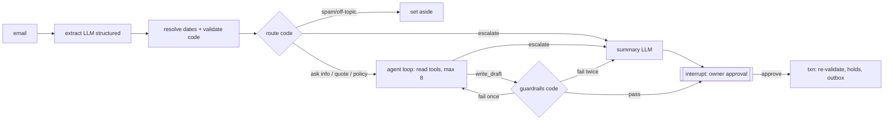

# SPEC: Reservations inbox agent (v1)

Status: agreed in design grilling, 2026-11-12. Supersedes `docs/BRIEF.md` where they differ (languages, time, budget, MCP scope).
All hotel, guest and owner data is fictional.

## Goal
An agent that drafts replies to guest emails for **Hotel Anemos** (14 rooms, fictional Cycladic island of **Psymithos**, owner George).
Code computes prices and availability; the model reads emails, picks tools and writes wording; the owner approves before anything is held or sent.
Secondary goal: a portfolio project showing agent design, guardrails, human-in-the-loop and honest evaluation.

## Users
One user, the owner, works through an overnight batch of 20–40 emails each morning. Success: inbox cleared in < 30 min, most drafts approved with at most a small edit, escalations clearly separated. Latency per email is secondary to cost.

## Scope
**In v1:** new availability/price requests and policy questions in **EN and EL**; extraction with `DateSpec`; code routing + agent loop on rails; code-rendered quotes; 7 guardrails; escalation with reason codes; approval with transactional holds and simulated outbox; Holds page; checkpoints/resume; audit log + monitoring; hybrid policy retrieval; MCP server (read-only); ~100-email evaluation; replay demo mode.
**Escalated, not drafted:** changes, cancellations, thread replies, other languages, complaints, discounts, groups, and the rules under *Escalation*.
**Out:** real mailbox, payments, multiple hotels, user accounts, channel managers, hosted always-on demo.
**Cut first if behind at end of week 6:** MCP (wk 9), then replay demo mode (wk 11). *(Q31 default, not explicitly confirmed.)*

## Decisions
| # | Decision | Because |
|---|---|---|
| D1 | Time: 20 h/week × 12 weeks; v1 feature-complete week 8 | Plan to reliable hours; extra hours are buffer |
| D2 | LLM budget **max $10 total**; OpenAI cheapest mini-tier model with structured outputs + tool calling (chosen in wk 4 after a 5-email Greek check); OpenAI small embedding model; hard usage limit | Minimal spend; credits on hand |
| D3 | All model calls behind an own **LLM adapter** (plain `openai` SDK) | Model/provider swappable by config; evaluation can compare |
| D4 | Mailbox behind an **adapter** (fake only in v1); emails stored with real-email fields; idempotent on `message_id`; sending via **outbox** table | Real mailbox in v2 is an add-on, not a rewrite |
| D5 | Input = plain-text `clean_body`, one language, one stay, ≤ 2 rooms (same dates), children with ages. **Greeklish** (Greek in Latin letters) is handled: extraction returns `language: el`, `script: latin`; reply in Greek script | Realistic hard cases; Greeklish is common for a Greek hotel |
| D6 | Model emits `DateSpec` (exact / relative / holiday / approximate + nights); **code** does all calendar maths (years, weekends Fri→Sun, Orthodox Easter, nights → check-out). Holiday `DateSpec` carries `tradition: orthodox / western / unspecified` as written by the guest; house rule in code: `unspecified` → Orthodox, and `{{REQUEST_SUMMARY}}` shows the resolved dates so the guest can correct them | Model handles language, code handles the calendar |
| D7 | Approximate period + length → window (early 1–10, mid 11–20, late 21–end; Easter ±3 d), stay must start in window, ≤ 3 options ≥ 2 days apart. Without length → ask for info | Real options, no invented numbers |
| D8 | Code renders `{{QUOTE_BLOCK}}` (prices) and `{{REQUEST_SUMMARY}}` (dates, guests, rooms); hold expiry into `{{HOLD_UNTIL}}` at approval. The model should write no digits outside these | Guardrails check blocks, not numbers in free text |
| D9 | Hold (48 h) **only if the quote matches exactly what the guest asked**; any substitution/options → no hold | Never block rooms the guest didn't request |
| D10 | Approval = one DB transaction: lock draft (`FOR UPDATE`) → flip holds past `expires_at` to `expired` → re-validate (always, any age) → holds → outbox → audit → `approved`. Graph resumed after commit. Double approve → 409; edited-price warnings → 422 unless `confirm_warnings` | DB is the source of truth; no double booking or double send |
| D11 | Graph **C, agent on rails**: code routes; one agent loop (read tools + `write_draft`/`escalate`, max 8 calls); Q14 rules enforced **inside tools**; model may escalate, never un-escalate | Real tool choice; money rules enforced by construction |
| D12 | Write tools (`hold_room`, `send_reply`) are never given to the model | Prompt injection can't call what isn't there |
| D13 | Infants < 2 in a cot don't count toward occupancy; everyone else does | Single clear capacity rule |
| D14 | Money in integer cents; deposit = ceil(30% of accommodation subtotal) to whole euro, integer-only; city tax separate, paid on arrival, not in deposit | Hand-checkable oracle, no float errors |
| D15 | Policies in English Markdown, ~25 heading chunks with stable `policy_id`; hybrid search (pgvector + Postgres full-text, RRF); model writes queries **in English**; `NO_MATCH` threshold on vector similarity → escalate | Honest retrieval, measurable vs. "all chunks in prompt" baseline |
| D16 | MCP: tools first as plain functions in `reservations/`; in wk 9 a thin MCP server exposes **read tools + resources only**, runs under a **read-only DB role** (SELECT + INSERT quotes); agent becomes its own MCP client | Reuse + career signal + a real permission boundary |
| D17 | One run per email (`thread_id = email_id`), LangGraph checkpoints in Postgres; unanswered 72 h → Expired; newer email from same guest → older draft *superseded*; no auto-send or auto-escalate, ever; resume in-flight runs on startup | A waiting draft is a proposal, not a promise |
| D18 | Local-first: Docker Compose runs **only Postgres** (pgvector image) until wk 11, then all services; `DEMO_MODE=replay` shows stored runs with no API key; optional manual Azure workflow | $0 hosting; one-command repo for reviewers |
| D19 | Shared owner password (env var + session cookie); `actor = owner` in audit | Public URL can't approve holds; no user table |
| D20 | Code uses an injected clock, never `datetime.now()` | Deterministic tests and evaluations |
| D21 | Test world = **season 2027**: season periods and min-stay rows seeded for 2027, rates per season; test `received_at` between Nov 2026 and Sep 2027; a date without a year resolves to the next future occurrence | The first season the agent would quote; reproducible evaluations |
| D22 | Expired holds never block: availability queries treat `hold` with `expires_at < now` as free (filter, no write); approval flips them (D10); the periodic job only tidies | Read tools stay read-only; correct from week 3 |
| D23 | Timestamps stored as `timestamptz` in **UTC**; the clock (D20) returns timezone-aware UTC; calendar logic (stay dates, < 48 h notice, check-in by 22:00, "next weekend", hold expiry shown to guests) uses hotel time **`Europe/Athens`** | One unambiguous storage format; guests and owner think in hotel local time |
| D24 | **Accommodation subtotal** = room nights + extra beds; city tax excluded. The deposit (D14) is 30% of it, rounded up to a whole euro | "Accommodation" is everything the hotel charges for the stay itself; city tax is collected on arrival |
| D25 | **Extra-bed payers:** leave out infants < 2 (D13), sort the rest by age, oldest first; the first `standard_occupancy` guests fill the standard places, every other guest pays the extra-bed rate for their own age | One deterministic rule; the youngest guests are the extra ones, the cheaper result for the guest |
| D26 | **Free-cancellation period** (14 d, or 30 d in High) is decided by the **arrival date's** season, even if later nights fall in High | Same principle as minimum stay, which also goes by arrival date |
| D27 | **Over capacity:** first a single room of the smallest type that fits everyone; only if no single type fits, split across 2 rooms | One room keeps a party together and is one booking; the cheaper 2-room option is not offered first, the owner can still propose it |

## Domain data
| Type | Rooms | Std/max | Extra bed | Notes |
|---|---|---|---|---|
| Standard Double | 6 | 2/2 | cot only | garden view |
| Sea View Double | 4 | 2/3 | 1 extra bed | balcony |
| Family Suite | 3 | 2/4 | sofa beds (persons 3–4 charged as extra beds) | kitchenette |
| Accessible Double | 1 | 2/2 | cot only | step-free; offered without stated need only if nothing else fits (owner flag) |

Open 15 Apr–31 Oct. Seasons: Low 15 Apr–31 May & Oct · Mid 1 Jun–14 Jul & Sep · High 15 Jul–31 Aug.
Rates € per room-night (Low/Mid/High): Std 70/95/140 · Sea 95/130/190 · Suite 140/180/260 · Accessible 70/95/140. Each night at its own season.
Min stay by **arrival date**: 1/2/3 nights; 5 for arrivals 10–20 Aug. Extra bed: child 2–11 €20, 12+ €35/night; cot free. City tax €1.50 (Low) / €4.00 (Mid/High) per room-night.
Policies: cancellation free until 14 d (High: 30 d) before arrival, then first night; deposit 30% within 48 h; check-in 15:00–22:00, out 11:00; no pets except assistance dogs; breakfast included for all 08:00–10:30; transfer €25/trip/car (≤ 4).
Unmet requests: other type free → ≤ 2 alternatives cheapest first · all booked → nearest same-length ranges ±7 d, else decline · min stay → quote min-stay version · over capacity → smallest single type that fits; only if none fits, 2 rooms (D27) · children without ages → ask · 3+ rooms or < 48 h to arrival → escalate · partly closed → offer open part.

## Data model
| Table | Key fields |
|---|---|
| `room_types`, `rooms` | type, std/max occupancy, extra-bed rule; room number |
| `seasons`, `season_periods` | season id (`low/mid/high`), `city_tax_cents`; season, date range. No overlap; a night in no period = closed |
| `room_rates` | type, season, `rate_cents`; one row per type × season, no dates |
| `min_stay_rules` | arrival range, nights; no overlap; dated (the 10–20 Aug rule cuts across High) |
| `bookings` | `room_id`, `stay daterange [in,out)`, `status hold/confirmed/cancelled/expired`, `expires_at`, `request_id`, `email_id`, `price_cents`. **Exclusion constraint** `(room_id WITH =, stay WITH &&)` where status in (hold, confirmed); needs `btree_gist` |
| `requests` | *planned, week 3*: the extracted request of an email (`DateSpec`, resolved dates, guests, rooms); target of `bookings.request_id` and `quotes.request` |
| `quotes` | request, nightly lines (JSON), subtotal, city tax, total, deposit, cancel deadline |
| `emails` | `message_id` (unique), `in_reply_to`, `thread_id`, `from_address`, `subject`, `raw_body`, `clean_body`, `language`, `received_at`, status |
| `drafts` | email, text versions, `quote_ids`, `proposed_holds`, guardrail results, status |
| `outbox` | draft, status `pending/sent (simulated)` |
| `policy_chunks` | `policy_id`, text, embedding (`vector`), tsvector |
| `audit_log` | append-only: run, step, event, input/output JSON, model, `prompt_version`, tokens, cost, latency, error, actor, at |

Tables are created by migrations in the week they are first needed. Week 1: inventory tables + `bookings`, with `bookings.email_id` and `request_id` as nullable columns without foreign keys. **Week 3 adds the foreign keys** for `bookings.email_id` and `request_id` once their target tables exist.

## Tools
| Tool | Reads/writes | Approval | Errors |
|---|---|---|---|
| `check_availability` | reads | no | `CLOSED`, `INVALID_DATES`, `MIN_STAY(n)` |
| `quote_price` | reads; stores quote (no inventory effect) | no | `OVER_CAPACITY`, `NO_RATE` (+ valid alternative attached) |
| `suggest_alternatives` | reads | no | `NONE_FOUND` |
| `search_policies` (English query) | reads | no | `NO_MATCH` |
| `hold_room` | **writes bookings** | **yes**, approval handler only | `NO_LONGER_AVAILABLE` |
| `send_reply` | **writes outbox** | **yes**, approval handler only | — |

Errors are typed return values. `find_reservation` → Later.

## Graph design

## Escalation rules
Reason codes (enum, raised by code or by `escalate(reason_code, note)`): `COMPLAINT`, `DISCOUNT`, `GROUP` (3+ rooms / no fit in 2), `CHANGE`, `CANCELLATION`, `THREAD_REPLY`, `LANGUAGE` (not EN/EL), `SHORT_NOTICE` (< 48 h), `LATE_ARRIVAL` (> 22:00), `NO_POLICY`, `GUARDRAIL_FAIL`, `LOOP_LIMIT`, `LEGAL`, `BILLING`, `MEDICAL`, `INJECTION`, `MODEL` (model judgement).
Owner gets: codes, 2–3 line English summary, extracted request, tool results so far; no draft. Pets and accessibility are handled, not escalated.
Extraction carries `flags: legal_threat | billing_request | medical_need | accessibility_need | injection_suspected` and `script: greek | latin`.

## Guardrails (code, every draft and every owner edit)
1. `{{QUOTE_BLOCK}}` exactly once on quote route; no other prices.
2. **Narrow:** free text outside the code-rendered blocks contains no digits, amounts, or date/time patterns, except exact substrings of retrieved policy chunks. Number words ("three nights") are not checked mechanically; measured in evaluation.
3. `{{REQUEST_SUMMARY}}` present when the route restates a request (dates then come only from code).
4. Reply language: EN email → Latin script; EL email (Greek or Greeklish) → Greek script.
5. No forbidden **phrases** per language ("booking is confirmed", "free upgrade", "guaranteed"…); template/policy wording allowed.
6. Cited `policy_id`s were retrieved in this run. *Limit: proves citation, not faithfulness; faithfulness is measured in evaluation.*
7. `proposed_holds` ⊆ run's quotes and satisfy D9.
Injection: email in delimited `<email>` block marked untrusted; structural defences D11/D12; detection → `INJECTION`. Owner edits that change a price → warning to confirm.

## Evaluation plan
Test set ~100 fictional emails (40 EN, 40 EL incl. ~4 Greeklish, 8 other languages, ~12 spam/off-topic/injection; ~30% escalations, each code ≥ 2×; traps: Easter (two cases: plain "Easter" from an English guest → Orthodox, quote for a stay starting 29 Apr–5 May 2027; "Catholic/Western Easter" → 28 Mar 2027 = `CLOSED` reply with opening date), season boundary, 10–20 Aug, Tetris availability, over-capacity, "50% off as agreed", missing ages, "next weekend", accessible room, date already passed → next year).
**Pinned `received_at` for date traps** (only 2027 is seeded, D21): Easter cases are received Nov 2026–Feb 2027 so both 2027 Easters are still future; "date already passed → next year" cases are received Nov–Dec 2026 and name a 2026 date already gone (e.g. "20 October"), so it resolves into 2027 rather than unseeded 2028. YAML labels with `schema_version`: gold extraction, route, reason codes, minimum tool calls, required `policy_id`s, holds, forbidden phrases; expected prices computed by unit-tested pricing code. Fixed `received_at` + seeded 2027 DB fixture. Written and labelled gradually: 30 in week 3, ~12/week in weeks 4–8.
Split 70 dev / 30 held-out, stratified. Dev runs ×1; held-out ×3 at milestones (pass = all 3). Each run records model, settings, commit, prompt versions, time → `eval/results/`.

| Metric | Target |
|---|---|
| Unsafe actions | 0 |
| Price in draft correct | 100% (enforced) |
| Escalation recall / precision | ≥ 95% / ≥ 80% |
| Route accuracy | ≥ 90% |
| Extraction: dates, adults, children ages | ≥ 95% each |
| Policy recall@3 | ≥ 90% |
| Guardrails pass first draft | ≥ 85% |
| Guardrail false alarms on correct drafts | ≤ 5% |
| Cost / email | ≤ $0.01 mean, ≤ $0.02 p95 |
| Latency / email p95 | ≤ 60 s |

Held-out numbers are indicative (±~10 pts at n = 30). Budget: dev $2 · dev evals $4 · milestone evals $3 · buffer $1. Real cost/email measured wk 6 → re-plan.

## Testing
`unit` (no DB, no network): pricing, dates, rules, formatting, guardrails. `integration` (local Postgres service): constraints, approval txn, 409, expiry, MCP role. Graph tests with a scripted fake model. API tests incl. 401. CI: lint, types, both markers; never evaluations.

## Milestones
| Wk | Milestone |
|---|---|
| 1 | Skeleton, compose (Postgres only), schema + migrations, seed data, clock, CI |
| 2 | `reservations/` core: availability, pricing, rules, `DateSpec`, Easter, formatting, quote template — unit-tested |
| 3 | Emails/drafts/outbox/bookings, fake adapter, approval txn (incl. expiring stale holds), holds, API with stub draft; first 30 test emails |
| 4 | LLM adapter, extraction, routing, Greek + Greeklish check, smoke set, extraction eval; +12 test emails |
| 5 | Policies + retrieval + retrieval eval; agent loop; +12 test emails |
| 6 | Guardrails, redraft, summaries, checkpoints/interrupt, audit log; end-to-end; **measure cost, re-plan**; +12 test emails |
| 7 | React inbox, detail, actions, holds, password; +12 test emails |
| 8 | Monitoring, test set complete (~100), first full dev eval — **v1 feature-complete** |
| 9 | Improve vs eval; MCP server + read-only role |
| 10 | Hardening: resume, re-validation, superseded, tidy-up job for expired holds |
| 11 | Full compose, replay mode, README + diagram, optional Azure workflow, held-out ×3 |
| 12 | Buffer, demo video, write-up |

Overruns cut buffer, then week-10 extras; never weeks 1–3 or the evaluation.

## Open items
- Dependencies to approve when first needed: `openai`, `langgraph` (+ Postgres checkpointer), DB driver + migrations tool, `pgvector` client, `mcp` + `langchain-mcp-adapters`, React tooling.
- Exact OpenAI model chosen in week 4.

## Later
Real mailbox (v2) · changes/cancellations + `find_reservation` · thread replies handled by agent · B (free agent) vs C baseline evaluation · German/other languages · repeat-guest history · local-model fallback · Batches API · MCP `request_hold` (creates pending approval only) · hosted demo · prices per year · special rates outside the three seasons.
*Why not in v1:* rates are keyed by room type + season with no dates of their own (`room_rates`), so rates and the season calendar cannot disagree; v1 quotes a single season of prices (D21), so neither feature is needed yet.
