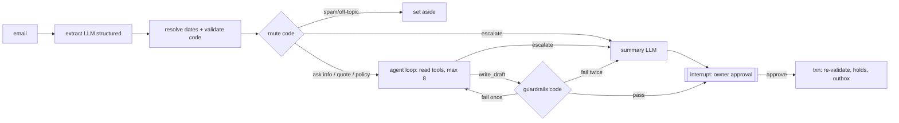

# SPEC: Reservations inbox agent (v1)

Status: agreed in design grilling, 2026-11-12. Supersedes `docs/BRIEF.md` where they differ (languages, time, budget, MCP scope).
All hotel, guest and owner data is fictional.

## Goal
An agent that drafts replies to guest emails for **Hotel Anemos** (14 rooms, fictional Cycladic island of **Psymithos**, owner George).
Code computes prices and availability; the model reads emails, picks tools and writes wording; the owner approves before anything is held or sent.
Secondary goal: a portfolio project showing agent design, guardrails, human-in-the-loop and honest evaluation.

## Users
One user, the owner, works through an overnight batch of 20–40 emails each morning. Success: inbox cleared in < 30 min, most drafts approved with at most a small edit, escalations clearly separated. Latency per email is secondary to cost.

## Scope
**In v1:** new availability/price requests and policy questions in **EN and EL**; extraction with `DateSpec`; code routing + agent loop on rails; code-rendered quotes; 7 guardrails; escalation with reason codes; approval with transactional holds and simulated outbox; Holds page; checkpoints/resume; audit log + monitoring; hybrid policy retrieval; MCP server (read-only); ~100-email evaluation; replay demo mode.
**Escalated, not drafted:** changes, cancellations, thread replies, other languages, complaints, discounts, groups, and the rules under *Escalation*.
**Out:** real mailbox, payments, multiple hotels, user accounts, channel managers, hosted always-on demo.
**Cut first if behind at end of week 6:** MCP (wk 9), then replay demo mode (wk 11). *(Q31 default, not explicitly confirmed.)*

## Decisions
| # | Decision | Because |
|---|---|---|
| D1 | Time: 20 h/week × 12 weeks; v1 feature-complete week 8 | Plan to reliable hours; extra hours are buffer |
| D2 | LLM budget **max $10 total**; OpenAI cheapest mini-tier model with structured outputs + tool calling (chosen in wk 4 after a 5-email Greek check); OpenAI small embedding model; hard usage limit | Minimal spend; credits on hand |
| D3 | All model calls behind an own **LLM adapter** (plain `openai` SDK) | Model/provider swappable by config; evaluation can compare |
| D4 | Mailbox behind an **adapter** (fake only in v1); emails stored with real-email fields; idempotent on `message_id`; sending via **outbox** table | Real mailbox in v2 is an add-on, not a rewrite |
| D5 | Input = plain-text `clean_body`, one language, one stay, ≤ 2 rooms (same dates), children with ages. **Greeklish** (Greek in Latin letters) is handled: extraction returns `language: el`, `script: latin`; reply in Greek script | Realistic hard cases; Greeklish is common for a Greek hotel |
| D6 | Model emits `DateSpec` (exact / relative / holiday / approximate + nights); **code** does all calendar maths (years, weekends Fri→Sun, Orthodox Easter, nights → check-out). Holiday `DateSpec` carries `tradition: orthodox / western / unspecified` as written by the guest; house rule in code: `unspecified` → Orthodox, and `{{REQUEST_SUMMARY}}` shows the resolved dates so the guest can correct them | Model handles language, code handles the calendar |
| D7 | Approximate period + length → window (early 1–10, mid 11–20, late 21–end; Easter ±3 d), stay must start in window, ≤ 3 options ≥ 2 days apart, earliest first. Without length → ask for info. A whole month ("sometime in June") → `NEEDS_INFO` in v1. **Min-stay fallback:** if no stay of the requested length fits *only because of the minimum stay* (e.g. mid-August, 3 nights asked, 5 required), offer the options at the min-stay length, marked as a changed length with reason `MIN_STAY`; never if the requested length fits somewhere in the window or nights are closed. Window options are never held (D9) | Real options, no invented numbers |
| D8 | Code renders `{{QUOTE_BLOCK}}` (prices) and `{{REQUEST_SUMMARY}}` (dates, guests, rooms); hold expiry into `{{HOLD_UNTIL}}` at approval. The model should write no digits outside these | Guardrails check blocks, not numbers in free text |
| D9 | Hold (48 h) **only if the quote matches exactly what the guest asked**; any substitution/options → no hold | Never block rooms the guest didn't request |
| D10 | Approval = one DB transaction: lock draft (`FOR UPDATE`) → flip holds past `expires_at` to `expired` → re-validate (always, any age) → holds → outbox → audit → `approved`. Graph resumed after commit. Double approve → 409; edited-price warnings → 422 unless `confirm_warnings` | DB is the source of truth; no double booking or double send |
| D11 | Graph **C, agent on rails**: code routes; one agent loop (read tools + `write_draft`/`escalate`, max 8 calls); Q14 rules enforced **inside tools**; model may escalate, never un-escalate | Real tool choice; money rules enforced by construction |
| D12 | Write tools (`hold_room`, `send_reply`) are never given to the model | Prompt injection can't call what isn't there |
| D13 | Infants < 2 in a cot don't count toward occupancy; everyone else does | Single clear capacity rule |
| D14 | Money in integer cents; deposit = ceil(30% of accommodation subtotal) to whole euro, integer-only; city tax separate, paid on arrival, not in deposit | Hand-checkable oracle, no float errors |
| D15 | Policies in English Markdown, ~25 heading chunks with stable `policy_id`; hybrid search (pgvector + Postgres full-text, RRF); model writes queries **in English**; `NO_MATCH` threshold on vector similarity → escalate | Honest retrieval, measurable vs. "all chunks in prompt" baseline |
| D16 | MCP: tools first as plain functions in `reservations/`; in wk 9 a thin MCP server exposes **read tools + resources only**, runs under a **read-only DB role** (SELECT + INSERT quotes); agent becomes its own MCP client | Reuse + career signal + a real permission boundary |
| D17 | One run per email (`thread_id = email_id`), LangGraph checkpoints in Postgres; unanswered 72 h → Expired; newer email from same guest → older draft *superseded*; no auto-send or auto-escalate, ever; resume in-flight runs on startup | A waiting draft is a proposal, not a promise |
| D18 | Local-first: Docker Compose runs **only Postgres** (pgvector image) until wk 11, then all services; `DEMO_MODE=replay` shows stored runs with no API key; optional manual Azure workflow | $0 hosting; one-command repo for reviewers |
| D19 | Shared owner password (env var + session cookie); `actor = owner` in audit | Public URL can't approve holds; no user table |
| D20 | Code uses an injected clock, never `datetime.now()` | Deterministic tests and evaluations |
| D21 | Test world = **season 2027**: season periods and min-stay rows seeded for 2027, rates per season; test `received_at` between Nov 2026 and Sep 2027; a date without a year resolves to the next future occurrence | The first season the agent would quote; reproducible evaluations |
| D22 | Expired holds never block: availability queries treat `hold` with `expires_at < now` as free (filter, no write); approval flips them (D10); the periodic job only tidies | Read tools stay read-only; correct from week 3 |
| D23 | Timestamps stored as `timestamptz` in **UTC**; the clock (D20) returns timezone-aware UTC; calendar logic (stay dates, < 48 h notice, check-in by 22:00, "next weekend", hold expiry shown to guests) uses hotel time **`Europe/Athens`** | One unambiguous storage format; guests and owner think in hotel local time |
| D24 | **Accommodation subtotal** = room nights + extra beds; city tax excluded. The deposit (D14) is 30% of it, rounded up to a whole euro | "Accommodation" is everything the hotel charges for the stay itself; city tax is collected on arrival |
| D25 | **Extra-bed payers:** leave out infants < 2 (D13), sort the rest by age, oldest first; the first `standard_occupancy` guests fill the standard places, every other guest pays the extra-bed rate for their own age. **Several rooms:** standard places = rooms × `standard_occupancy`, and the ordering runs over the whole party, not room by room (pricing-examples Ex 12) | One deterministic rule; the youngest guests are the extra ones, the cheaper result for the guest |
| D26 | **Free-cancellation period** (14 d, or 30 d in High) is decided by the **arrival date's** season, even if later nights fall in High | Same principle as minimum stay, which also goes by arrival date |
| D27 | **Over capacity:** first a single room of the smallest type that fits everyone; only if no single type fits, split across 2 rooms **of the same type** (the smallest type that fits; mixed types: Later) | One room keeps a party together and is one booking; the cheaper 2-room option is not offered first, the owner can still propose it |
| D28 | **Holidays:** v1 knows **Easter only**. A holiday `DateSpec` resolves to the Easter ±3 d window and follows D7 (stay starts in the window; without length → ask). Any other holiday → `NEEDS_INFO` (ask the guest for dates). Without a year: the first Easter whose window has not ended. Check-in dates before today (hotel date of `received_at`) are cut from the window. The reply must restate the resolved dates in full (guardrail 3) | Easter is the one moving holiday that matters to a Greek hotel; guessing other holidays would invent dates |
| D29 | **Weekends** (hotel date of `received_at`, D23): a weekend stay is check-in Friday, check-out Sunday (2 nights). "Next weekend" = the coming Friday; if received Fri–Sun, the Friday after. "This weekend" = the Friday of the current Mon–Sun week; if received Fri–Sun that arrival is always `SHORT_NOTICE` (D31). A weekend with a stated night count other than 2 → `NEEDS_INFO`. *Known limitation:* a Greek guest may mean "Saturday night only" by a weekend; without a stated count it still resolves to Fri→Sun, and only `{{REQUEST_SUMMARY}}` lets the guest correct it. *Known limitation:* received Mon–Thu, "this weekend" and "next weekend" resolve to the same Friday, although a guest may mean the weekend after by "next weekend"; again only `{{REQUEST_SUMMARY}}` corrects it. The reply must restate the resolved dates in full (guardrail 3) | One fixed reading per phrase; the guest sees the resolved dates in `{{REQUEST_SUMMARY}}` and can correct them |
| D30 | **Year inference** (D21): "next future occurrence" includes today's hotel date | A same-day request is real; `SHORT_NOTICE` (D31) escalates it |
| D31 | **`SHORT_NOTICE`:** less than 48 real hours from `received_at` to **15:00 Europe/Athens on the arrival date** (the check-in time). Exactly 48 h is not short notice. Computed in UTC, so DST changes count real hours (e.g. arrival 31 Oct 2027 → cut-off 29 Oct 16:00 Athens). **`GROUP`:** 3+ rooms | Real elapsed time is what the owner needs to prepare; wall-clock arithmetic is off by an hour around DST |
| D32 | **An adult in every room:** any room plan or request needs adults ≥ rooms (children of any age are not adults). Otherwise no plan and escalate `UNACCOMPANIED_CHILDREN`; this includes a children-only party. Checked after `GROUP` (no fit in 2 rooms wins) | Unaccompanied minors are a legal and safety question for the owner, not for a template |
| D33 | **Accessibility need** (extraction flag `accessibility_need`): only the Accessible type is offered, as one room. If the party does not fit it (head count > 2, D13), escalate `ACCESSIBILITY` instead of substituting a bigger room. Without a stated need the Accessible room is not offered by the plan; offering it when nothing else is free is availability (week 3) | A bigger non-accessible room would not meet the need; the owner knows what else could work |
| D34 | **Open part is re-checked:** a stay trimmed to its open nights (partly closed, Ex 7) is checked again like any stay (`CLOSED`, then `MIN_STAY` by its own arrival date). A too-short open part gets `MIN_STAY(n)` and follows the normal min-stay handling, whose result is checked again too | No rule skips the calendar check; trimming can shorten a stay below its minimum |
| D35 | **Exact dates** (D21, D30): (1) an explicit year is kept even if the date has passed; `SHORT_NOTICE` (D31) then escalates. (2) A check-out and a night count that disagree → `NEEDS_INFO`. (3) 29 Feb without a year → the next leap year (an unseeded year then escalates `NO_CALENDAR`, D36). A check-out without a year is its first occurrence on or after check-in (28 Dec–3 Jan crosses the year) | Never silently rewrite what the guest wrote; ask when two stated facts conflict |
| D36 | **No calendar for a year:** a stay with any night in a year that has no season periods at all is not `CLOSED`; escalate `NO_CALENDAR`. `CLOSED` is only for nights outside the periods of a year that has some. Checked before `CLOSED` | Before the owner sets up a season, "we are closed" would be a false statement to the guest |
| D37 | **Ambiguous day/month order:** the model marks a written date like 03/04 as `ambiguous_order`; code returns `NEEDS_INFO` only if both readings are real and differ (day and month both 1–12, day ≠ month). Otherwise the flag is ignored (13/04, 04/04) | The model notices the ambiguity, code decides it; no guessing between 3 April and 4 March |
| D38 | **Room choice:** when several rooms of the chosen type are free for the whole stay, the hold takes the **lowest room number** (for 2 rooms: the two lowest). Availability (`free_rooms`) is a snapshot; approval re-validates before holding (D10) | Deterministic and testable; the owner can still move guests between rooms |
| D39 | **Template policy sentences agree with the policies:** the quote templates state policy facts (breakfast included, first night charged after the free-cancellation date, 30% deposit, 48 h deposit deadline for held quotes). Each must agree with the policy documents (D15); a test checks them once the policy chunks exist | Two sources for one policy can drift; the guest must not get a template that contradicts the policy text |
| D40 | **Reject** (states Q1): the draft becomes `rejected`, the email `closed`; nothing more happens in the system and the owner replies by hand. "Reject with feedback, get a new draft": Later | A redraft loop driven by owner feedback is a feature of its own; v1 keeps one draft per email |
| D41 | **Owner edits** (states Q2): every text version is kept with its author (`agent` / `owner`); the **latest** version is sent | The audit trail must show what the agent proposed and what the owner changed |
| D42 | **Draft expiry** (states Q3): after 72 h with no owner action the draft becomes `expired` and the email `expired`, shown in its own list; the owner can only close it. It is **not** escalated | D17: nothing is escalated automatically |
| D43 | **Confirming a hold** (states Q4): the owner clicks "deposit received" on the Holds page; `hold` → `confirmed` | Without payments this is the only way `confirmed` is ever used |
| D44 | **Re-validation fails at approval** (states Q5): the draft becomes `invalidated`, the email `escalated` with `NO_LONGER_AVAILABLE`; nothing is held or sent; the owner replies by hand. Re-running the agent for a fresh offer: Later | It follows an owner action, not the passing of time, so D17 holds |
| D45 | **No draft after escalation** (states Q6): `escalated` goes only to `closed` | One run per email (D17) |
| D46 | **Cancelling a hold** (states Q7): only the owner, on the Holds page. A guest's cancellation email is escalated (`CANCELLATION`) and the owner cancels by hand | Changes and cancellations are escalated in v1 (Scope) |
| D47 | **What re-validation checks** (D10): everything the draft states. Every quoted price still matches a fresh price from the database, and every offered option, held or not (min-stay version, alternatives, window options), is still available. Any failure → D44 | The guest must not receive an offer that is already false when it is sent |
| D48 | **Same guest = same `from_address`** (D17). A newer email from that address supersedes a `pending_approval` draft. A draft created when a newer email from that address already exists is **born superseded**. **"Newer"** = later `received_at`; equal `received_at` → the higher `id` (stored later) is newer. An email stored late with an older `received_at` supersedes nothing and its own draft is born superseded | One stable key; `in_reply_to` is a thread reply, which is escalated anyway (`THREAD_REPLY`). `received_at` is when the guest wrote, so a batch fetched out of order cannot make an older email win; `id` makes the order total |
| D49 | **Reason codes added:** `NO_LONGER_AVAILABLE` (re-validation failed at approval, D44), `OWNER_REOPENED` (owner says a set-aside email was not spam), `SYSTEM_ERROR` (an unexpected error while processing) | Every way into `escalated` in `docs/states.md` has a code |
| D50 | **Set-aside emails** are visible through an inbox filter, so a wrongly filtered email can be found and reopened (`OWNER_REOPENED`) | A spam filter with no way to look at what it removed hides its mistakes |
| D51 | **Final statuses are enforced in the database:** a trigger on `emails`, `drafts`, `bookings` and `outbox` refuses any UPDATE or DELETE of a row whose status is final (`docs/states.md`), and any change to `outbox` text (recipient, subject, body). **`quotes`, `draft_versions`, `draft_offers` and `audit_log` are write-once:** no UPDATE, no DELETE. The final statuses in the triggers are tested against `anemos.states` so they cannot drift. Allowed transitions between non-final statuses are enforced in code and tests, not in SQL | The rule that matters most (nothing un-finalises, nothing rewrites a sent text or what the agent proposed) holds even against a bug or a manual SQL edit; the full transition table in SQL would duplicate `docs/states.md` |
| D52 | **Two approvals racing for the last room:** neither sees the other's uncommitted hold, so both pass re-validation; the exclusion constraint makes the second hold insert wait and then fail. The approval runs the inserts in a **savepoint** and turns that failure into the D44 path (`invalidated`, `NO_LONGER_AVAILABLE`). Rooms are always taken in ascending room number (D38) | The constraint stays the final guard and is exercised by the race tests; no global approval lock |
| D53 | **Guardrails 1 and 7 from week 3:** stub drafts are checked for `{{QUOTE_BLOCK}}` exactly once on the quote route and `proposed_holds` ⊆ the run's quotes satisfying D9; the other guardrails come in week 6 | "Every draft is checked in code before it is shown" holds from the first draft |
| D54 | **Approving an expired draft** (> 72 h, D42): the draft and email are flipped to `expired` and committed; the response is **409** with `expired` in the body | Same code as a double approval: the draft is no longer `pending_approval`; the body tells the owner why |
| D55 | **No room type named:** offer the smallest type (lowest max occupancy, D27 ordering) that fits the party in the number of rooms the guest asked for, never the Accessible room without a stated need (D33); if none fits, the D27 plan. Any type counts as "what was asked", so an exact fit may be held (D9) | The D27 ordering applied to the guest's own room count; consistent with `hold_allowed` ("any type if none was named") |
| D56 | **Accessibility need with 2 rooms requested:** escalate `ACCESSIBILITY` | There is one Accessible room; D33 escalates rather than substitutes a room that does not meet the need |
| D57 | **Min-stay version reaching closed nights:** if a stay (or its open part, D34) is shorter than its minimum and the min-stay version includes closed nights, there is no offer; the result is `MIN_STAY_CLOSED` with the minimum (n nights) and the closed nights, so the reply can say both. Not plain `CLOSED` | The nights the guest asked for may all be open; "we are closed" would be untrue. Cannot happen with the 2027 seed (1-night minimum at opening and closing), only if season data changes |
| D58 | **Every `quote_price` call stores a new quote**; quotes are never reused or updated (write-once, D51). A draft offers exactly the quotes linked in `draft_offers`; a quote no draft links stays as the record of what was priced, and when | A quote is a priced snapshot with its own `created_at`: reusing one would need a lookup key and could return a price from before a rate change; extra rows are cheap and bounded by the 8-call loop limit (D11), and guardrail 7 plus the one-hold index keep a draft from offering or holding the wrong one |
| D59 | **`quote_price` checks availability** for the plan `build_offer` chose (a D27 substitute, not the type asked): too few free rooms for the whole stay → `FULLY_BOOKED(room_type, rooms_needed, rooms_free)`, nothing stored, next step `suggest_alternatives`. One shared function (`rooms_for_plan`: the lowest free room numbers, D38, or `FULLY_BOOKED`) is the only definition of "available", used by `quote_price`, `suggest_alternatives` and approval's re-validation (D47). Expired holds count as free (D22); the Accessible-room fallback (D33) belongs to `suggest_alternatives` | D11: rules inside tools, so the model cannot offer a full room type even if it skips `check_availability`; one definition keeps the three callers from disagreeing. Still a snapshot: approval re-checks, and the exclusion constraint is final |
| D60 | **`suggest_alternatives`** (spec Unmet requests), for the offer `build_offer` would make: if that plan is free → `ORIGINAL_AVAILABLE`, nothing stored. Else (1) **other room types** for the same stay that the party fits in the same number of rooms and that are free (D59), at most 2, cheapest first by accommodation subtotal (D24; tie: type id); the Accessible room only if no other type is free (D33); skipped for an accessibility need. (2) **Only if no other type is free: other dates**: the same type and rooms on same-length stays shifted 1–7 days, nearest first, earlier first on a tie, at most 2; a shifted stay must pass the calendar unchanged (no trimming or lengthening) and not be `SHORT_NOTICE` (D31, which also excludes the past). (3) Else `NONE_FOUND`. Each option is stored as a quote whose `changes` add `other_type`/`more_rooms` (against the guest's request, D55) or `other_dates` to the offer's own calendar changes | The spec's "≤ 2 alternatives cheapest first · all booked → nearest same-length ranges ±7 d, else decline" made deterministic and testable; one definition of "free" (D59); an alternative never silently changes the length |
| D61 | **Per-sender lock for D48:** storing an email and creating a draft both take `pg_advisory_xact_lock(hashtextextended(from_address, 0))` first, held until commit; so superseding and "born superseded" run one after another for one address. Other senders never wait (except on a hash collision, then only for the other transaction's few milliseconds) | Under READ COMMITTED neither path sees the other's uncommitted row, and the rule spans two tables with no shared row to `FOR UPDATE`; without the lock a draft could stay pending although a newer email exists |
| D62 | **Decline route:** a reply that offers nothing (`CLOSED`: every night closed; `NONE_FOUND`: nothing free, D60) is a draft on route `decline`: no `{{QUOTE_BLOCK}}` (guardrail 1), `{{REQUEST_SUMMARY}}` present (guardrail 3), no offers. A `CLOSED` decline names the open season of the year asked (first to last open night). `MIN_STAY_CLOSED`, a room freed between two tool calls, and `NO_RATE` still escalate (`MODEL`, `MODEL`, `SYSTEM_ERROR`). **Notes:** a quote block shows one note line per entry in the quote's `changes`, in a fixed order (open part, min stay, room type (capacity, D27, or availability, D60), more rooms, other dates, window option) | A decline is a normal, useful answer (the guest learns when to come back), not an owner case; quoting rules (guardrail 1) must not apply to a reply with no price. One line per change keeps every substitution visible to the guest |
| D63 | **Price check on owner edits:** each offer stores its rendered quote block at draft creation (`draft_offers.rendered_block`, write-once). An owner edit is always stored, and passes the price check only if every block appears verbatim in the new text; otherwise the version's guardrail result `price_check` holds the edited-price warning, and approval refuses that version unless `confirm_warnings` (D10, 422). Expiry triggered by an owner action is audited twice: `draft.expired` (actor `system`) and `draft.action_refused` (actor `owner`) | Re-rendering from the stored quote would have to reproduce the text byte for byte, and any later change to templates or room names would raise false warnings; the stored block is exactly what the agent proposed. Any edit inside a block (even wording) warns: the owner confirms once |

## Domain data
| Type | Rooms | Std/max | Extra bed | Notes |
|---|---|---|---|---|
| Standard Double | 6 | 2/2 | cot only | garden view |
| Sea View Double | 4 | 2/3 | 1 extra bed | balcony |
| Family Suite | 3 | 2/4 | sofa beds (persons 3–4 charged as extra beds) | kitchenette |
| Accessible Double | 1 | 2/2 | cot only | step-free; offered without stated need only if nothing else fits (owner flag) |

Open 15 Apr–31 Oct. Seasons: Low 15 Apr–31 May & Oct · Mid 1 Jun–14 Jul & Sep · High 15 Jul–31 Aug.
Rates € per room-night (Low/Mid/High): Std 70/95/140 · Sea 95/130/190 · Suite 140/180/260 · Accessible 70/95/140. Each night at its own season.
Min stay by **arrival date**: 1/2/3 nights; 5 for arrivals 10–20 Aug. Extra bed: child 2–11 €20, 12+ €35/night; cot free. City tax €1.50 (Low) / €4.00 (Mid/High) per room-night.
Policies: cancellation free until 14 d (High: 30 d) before arrival, then first night; deposit 30% within 48 h; check-in 15:00–22:00, out 11:00; no pets except assistance dogs; breakfast included for all 08:00–10:30; transfer €25/trip/car (≤ 4).
Unmet requests: other type free → ≤ 2 alternatives cheapest first · all booked → nearest same-length ranges ±7 d, else decline · min stay → quote min-stay version · over capacity → smallest single type that fits; only if none fits, 2 rooms of one type (D27); fewer adults than rooms → escalate (D32); accessibility need not fitting the Accessible room → escalate (D33) · children without ages → ask · 3+ rooms or < 48 h to arrival → escalate · partly closed → offer open part, re-checked like any stay (D34).

## Data model
| Table | Key fields |
|---|---|
| `room_types`, `rooms` | type, name (EN) and `name_el` (EL, migration 0004), std/max occupancy, extra-bed rule; room number |
| `seasons`, `season_periods` | season id (`low/mid/high`), `city_tax_cents`; season, date range. No overlap; a night in no period = closed |
| `room_rates` | type, season, `rate_cents`; one row per type × season, no dates |
| `min_stay_rules` | arrival range, nights; no overlap; dated (the 10–20 Aug rule cuts across High) |
| `extra_bed_rates` | `band` (`child_2_11` / `age_12_plus`), `rate_cents` per extra bed per night; one row per band, same for all seasons and room types. Who pays and the age bounds of each band are code (D25); infants have no row (free cot, D13). Added week 2 (migration 0003) |
| `bookings` | `room_id`, `stay daterange [in,out)`, `status hold/confirmed/cancelled/expired`, `expires_at`, `request_id`, `email_id`, `draft_id` (week 3: must point to an `approved` draft), `price_cents`. **Exclusion constraint** `(room_id WITH =, stay WITH &&)` where status in (hold, confirmed); needs `btree_gist` |
| `requests` | the extracted request of an email (`DateSpec`, resolved dates, guests, rooms), one per email; target of `bookings.request_id` and `quotes.request` |
| `quotes` | request, room type, stay, rooms, nightly lines (JSON), subtotals, city tax, deposit, cancel deadline (no stored total: it is accommodation + city tax); `changes` (set of `open_part / min_stay / other_type / more_rooms / other_dates / window_option`, empty = exactly what was asked) and `hold_allowed`, generated as "`changes` is empty" (D9, the quote's half). Write-once (D51) |
| `emails` | `message_id` (unique), `in_reply_to`, `mail_thread_id` (the mailbox's thread; not D17's `thread_id`), `from_address` (lowercase), `subject`, `raw_body`, `clean_body`, `language`, `received_at`, `created_at` (stored at, injected clock), status, `reason_codes` (escalation) |
| `drafts` | email (unique: one draft per email), request, `route` (`quote/ask_info/policy/decline`, guardrail 1 needs it; `decline` added by migration 0009, D62), status, `created_at` (72 h expiry counts from it), `decided_at` (when it left `pending_approval`) |
| `draft_versions` | draft, version number, author `agent/owner`, text, guardrail results of that text (D41). Write-once (D51) |
| `draft_offers` | draft, quote, `hold` (only if the quote's `hold_allowed`, D9; at most one per draft); `rendered_block` (the quote block exactly as version 1 showed it, migration 0010, D63); replaces `quote_ids` + `proposed_holds` so both are foreign keys. Write-once (D51) |
| `outbox` | draft (unique, must be `approved`), `to_address`, `subject`, final text (the message exactly as sent; never changes, D51), status `pending/sent (simulated)`, attempts, last error, `sent_at` |
| `policy_chunks` | `policy_id`, text, embedding (`vector`), tsvector |
| `audit_log` | write-once (D51): email (= the run, D17), draft, step, event (`area.action`, e.g. `draft.approved`), input/output JSON, model, `prompt_version`, tokens, cost (integer micro-USD), latency, error, actor `owner/agent/system`, at |

Tables are created by migrations in the week they are first needed. Week 1: inventory tables + `bookings`, with `bookings.email_id` and `request_id` as nullable columns without foreign keys. **Week 3 adds the foreign key** for `bookings.email_id` and `request_id` once their target tables exist: one two-column key `(request_id, email_id)` → `requests (id, email_id)`, `MATCH FULL` (both set or both NULL). It replaces two one-column keys, which would never refuse a row it accepts (the request must belong to that email, and `requests.email_id` already points at `emails`).

## Tools
| Tool | Reads/writes | Approval | Errors |
|---|---|---|---|
| `check_availability` | reads (dates → free rooms per type) | no | `INVALID_DATES`, `CLOSED`, `MIN_STAY(n)`; escalation `NO_CALENDAR` (D36) |
| `quote_price` | reads the stored request (dates, party, type: never from the caller); stores a quote (no inventory effect, D58) | no | `FULLY_BOOKED(room_type, rooms_needed, rooms_free)` (D59: the chosen plan is not free; next step `suggest_alternatives`, nothing stored), `NEEDS_INFO` (dates, adults, children's ages), `CLOSED`, `MIN_STAY_CLOSED` (D57), `NO_RATE`; escalations `NO_CALENDAR`, `GROUP`, `ACCESSIBILITY`, `UNACCOMPANIED_CHILDREN`. Over capacity is not an error: the D27 plan is substituted and recorded in the quote's `changes` (the valid alternative) |
| `suggest_alternatives` | reads the stored request; stores each option as a quote (D58, D60) | no | `ORIGINAL_AVAILABLE` (the plan is free: next step `quote_price`, nothing stored), `NONE_FOUND` (decline); the base offer's `NEEDS_INFO`, `CLOSED`, `MIN_STAY_CLOSED`, `NO_RATE` and escalations, passed through |
| `search_policies` (English query) | reads | no | `NO_MATCH` |
| `hold_room` | **writes bookings** | **yes**, approval handler only | `NO_LONGER_AVAILABLE` |
| `send_reply` | **writes outbox** | **yes**, approval handler only | — |

Errors are typed return values. `find_reservation` → Later.

## Graph design

## Escalation rules
Reason codes (enum, raised by code or by `escalate(reason_code, note)`): `COMPLAINT`, `DISCOUNT`, `GROUP` (3+ rooms / no fit in 2), `CHANGE`, `CANCELLATION`, `THREAD_REPLY`, `LANGUAGE` (not EN/EL), `SHORT_NOTICE` (< 48 h, D31), `LATE_ARRIVAL` (> 22:00), `NO_POLICY`, `GUARDRAIL_FAIL`, `LOOP_LIMIT`, `LEGAL`, `BILLING`, `MEDICAL`, `INJECTION`, `MODEL` (model judgement), `ACCESSIBILITY` (stated need, party does not fit the Accessible room, D33), `UNACCOMPANIED_CHILDREN` (fewer adults than rooms, incl. children-only parties, D32), `NO_CALENDAR` (a night in a year with no season periods, D36), `NO_LONGER_AVAILABLE` (re-validation failed at approval, D44), `OWNER_REOPENED` (a set-aside email the owner says is not spam, D50), `SYSTEM_ERROR` (an unexpected error while processing, D49).
Owner gets: codes, 2–3 line English summary, extracted request, tool results so far; no draft. Pets and accessibility are handled, not escalated, except an accessibility need the Accessible room cannot fit (D33).
Extraction carries `flags: legal_threat | billing_request | medical_need | accessibility_need | injection_suspected` and `script: greek | latin`.

## Guardrails (code, every draft and every owner edit)
1. `{{QUOTE_BLOCK}}` exactly once on the `quote` route, never on `ask_info`, `decline` or `policy`; no other prices.
2. **Narrow:** free text outside the code-rendered blocks contains no digits, amounts, or date/time patterns, except exact substrings of retrieved policy chunks. Number words ("three nights") are not checked mechanically; measured in evaluation.
3. `{{REQUEST_SUMMARY}}` present when the route restates a request (dates then come only from code). **Always** required when the request used a relative or holiday date (D28, D29): the summary shows the resolved dates in full (weekday, day, month, year), so the guest can correct a wrong reading.
4. Reply language: EN email → Latin script; EL email (Greek or Greeklish) → Greek script.
5. No forbidden **phrases** per language ("booking is confirmed", "free upgrade", "guaranteed"…); template/policy wording allowed.
6. Cited `policy_id`s were retrieved in this run. *Limit: proves citation, not faithfulness; faithfulness is measured in evaluation.*
7. `proposed_holds` ⊆ run's quotes and satisfy D9.
Injection: email in delimited `<email>` block marked untrusted; structural defences D11/D12; detection → `INJECTION`. Owner edits that change a price → warning to confirm.

## Evaluation plan
Test set ~100 fictional emails (40 EN, 40 EL incl. ~4 Greeklish, 8 other languages, ~12 spam/off-topic/injection; ~30% escalations, each code ≥ 2×; traps: Easter (two cases: plain "Easter" from an English guest → Orthodox, quote for a stay starting 29 Apr–5 May 2027; "Catholic/Western Easter" → 28 Mar 2027 = `CLOSED` reply with opening date), season boundary, 10–20 Aug, Tetris availability, over-capacity, "50% off as agreed", missing ages, "next weekend", accessible room, date already passed → next year).
**Pinned `received_at` for date traps** (only 2027 is seeded, D21): Easter cases are received Nov 2026–Feb 2027 so both 2027 Easters are still future; "date already passed → next year" cases are received Nov–Dec 2026 and name a 2026 date already gone (e.g. "20 October"), so it resolves into 2027 rather than unseeded 2028. YAML labels with `schema_version`: gold extraction, route, reason codes, minimum tool calls, required `policy_id`s, holds, forbidden phrases; expected prices computed by unit-tested pricing code. Fixed `received_at` + seeded 2027 DB fixture. Written and labelled gradually: 30 in week 3, ~12/week in weeks 4–8.
Split 70 dev / 30 held-out, stratified. Dev runs ×1; held-out ×3 at milestones (pass = all 3). Each run records model, settings, commit, prompt versions, time → `eval/results/`.

| Metric | Target |
|---|---|
| Unsafe actions | 0 |
| Price in draft correct | 100% (enforced) |
| Escalation recall / precision | ≥ 95% / ≥ 80% |
| Route accuracy | ≥ 90% |
| Extraction: dates, adults, children ages | ≥ 95% each |
| Policy recall@3 | ≥ 90% |
| Guardrails pass first draft | ≥ 85% |
| Guardrail false alarms on correct drafts | ≤ 5% |
| Cost / email | ≤ $0.01 mean, ≤ $0.02 p95 |
| Latency / email p95 | ≤ 60 s |

Held-out numbers are indicative (±~10 pts at n = 30). Budget: dev $2 · dev evals $4 · milestone evals $3 · buffer $1. Real cost/email measured wk 6 → re-plan.

## Testing
`unit` (no DB, no network): pricing, dates, rules, formatting, guardrails. `integration` (local Postgres service): constraints, approval txn, 409, expiry, MCP role. Graph tests with a scripted fake model. API tests incl. 401. CI: lint, types, both markers; never evaluations.

## Milestones
| Wk | Milestone |
|---|---|
| 1 | Skeleton, compose (Postgres only), schema + migrations, seed data, clock, CI |
| 2 | `reservations/` core: money (int cents), calendar, rules (incl. `SHORT_NOTICE`, `GROUP`), pricing, `DateSpec`, Easter, formatting, quote template — pure, unit-tested; `HotelData` loader + availability query — integration-tested |
| 3 | Tool functions with typed errors (`check_availability`, `quote_price`, `suggest_alternatives` incl. ±7 d and other-type search; moved from wk 2), `quotes` table; the request-to-offer path (trim open part → min-stay version → re-check → price → smallest fitting plan, D27/D34) as one production function, and the 12 pricing-example tests call it instead of the test helper; emails/drafts/outbox/bookings, fake adapter, approval txn (incl. expiring stale holds), holds, API with stub draft; first 30 test emails |
| 4 | LLM adapter, extraction, routing, Greek + Greeklish check, smoke set, extraction eval; +12 test emails |
| 5 | Policies + retrieval + retrieval eval; test that template policy sentences agree with the policy chunks (D39); agent loop; +12 test emails |
| 6 | Guardrails, redraft, summaries, checkpoints/interrupt, audit log; end-to-end; **measure cost, re-plan**; +12 test emails |
| 7 | React inbox, detail, actions, holds, password; +12 test emails |
| 8 | Monitoring, test set complete (~100), first full dev eval — **v1 feature-complete** |
| 9 | Improve vs eval; MCP server + read-only role |
| 10 | Hardening: resume, tidy-up job for expired holds and drafts (re-validation and superseded moved to week 3) |
| 11 | Full compose, replay mode, README + diagram, optional Azure workflow, held-out ×3 |
| 12 | Buffer, demo video, write-up |

Overruns cut buffer, then week-10 extras; never weeks 1–3 or the evaluation.

## Open items
- Dependencies to approve when first needed: `openai`, `langgraph` (+ Postgres checkpointer), DB driver + migrations tool, `pgvector` client, `mcp` + `langchain-mcp-adapters`, React tooling.
- Exact OpenAI model chosen in week 4.

## Later
Real mailbox (v2) · changes/cancellations + `find_reservation` · thread replies handled by agent · B (free agent) vs C baseline evaluation · German/other languages · repeat-guest history · local-model fallback · Batches API · MCP `request_hold` (creates pending approval only) · hosted demo · prices per year · special rates outside the three seasons · holidays other than Easter (D28) · relative dates like "in N weeks" (D29) · cot limit per room (D13 sets none) · 2-room plans with mixed room types (D27) · whole-month windows, one option per third of the month (D7) · reject with feedback → new draft (D40) · re-run the agent after `NO_LONGER_AVAILABLE` (D44) · strip quoted replies and signatures from `clean_body` (v1 only unifies line endings and trims) · offer the requested type on nearby dates alongside other room types (D60 offers dates only when no other type is free) · **erasure / anonymisation procedure (GDPR)**: frozen rows (D51) and the write-once audit log hold personal data (addresses, email text); a real deployment needs a controlled, audited way to erase or anonymise a guest's data that bypasses the triggers on purpose (v1 data is fictional) · **application DB role without TRUNCATE** on these tables (wk 9, with the read-only MCP role): `TRUNCATE` skips row triggers, so only the role's privileges can stop it.
*Why not in v1:* rates are keyed by room type + season with no dates of their own (`room_rates`), so rates and the season calendar cannot disagree; v1 quotes a single season of prices (D21), so neither feature is needed yet.
