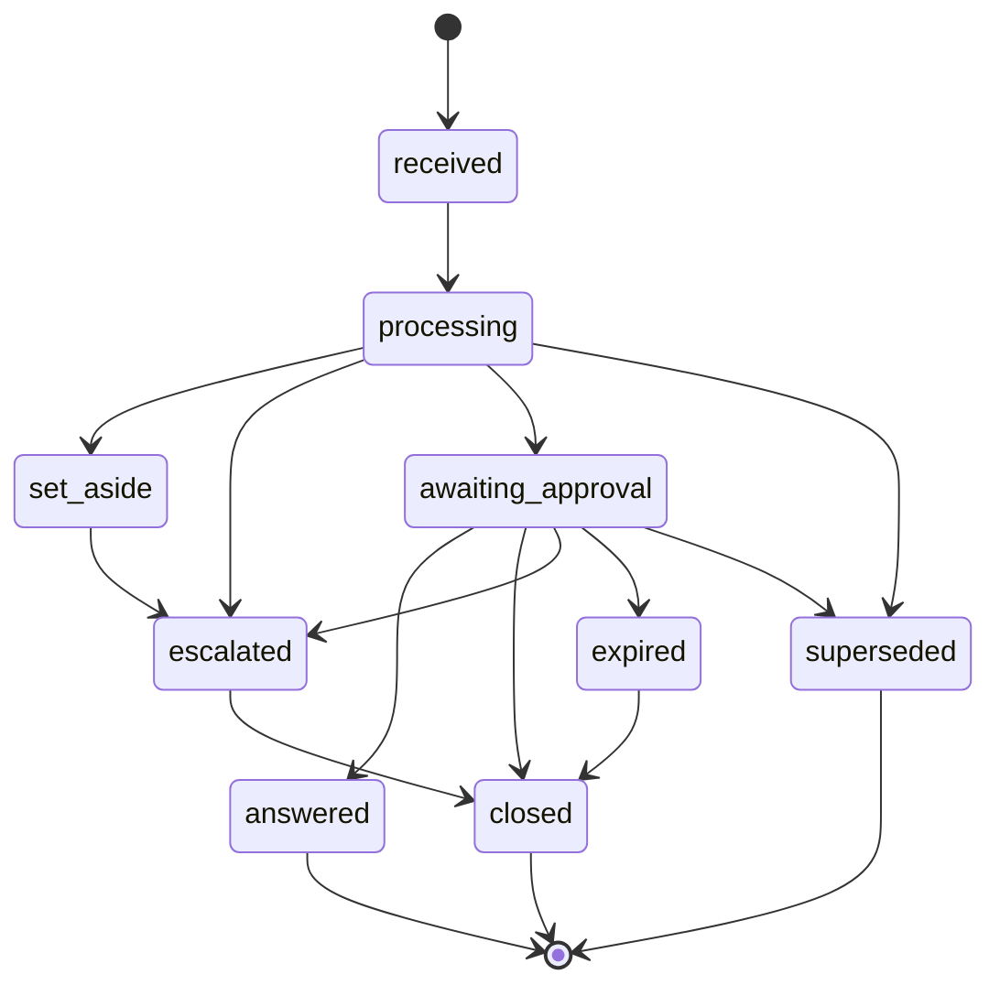
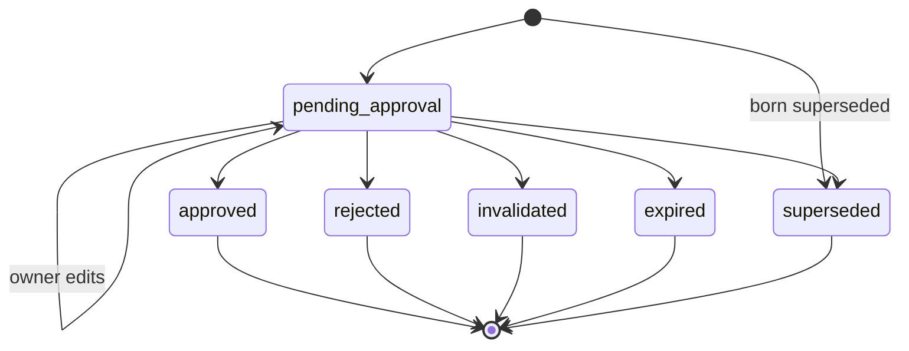

# States and transitions

Every status an email, a draft, a booking and an outbox message can have, and what is allowed
to move each one from one status to the next. The schema, the approval transaction and the
tests in week 3 follow this file. If the code needs a transition that is not listed here,
stop and add it here first.

Conventions:
- **Final** means no transition leaves that status.
- **Time-based statuses are decided against the injected clock at the moment of an action**
  (same pattern as D22). A read never writes. Something that is past its deadline but not
  yet flipped is treated as already expired by every action.
- "Same transaction" means both changes happen or neither does.
- **"A newer email from the same guest"** (D48): same `from_address`, and a later
  `received_at`; with equal `received_at`, the higher email `id` (stored later) is newer.
  An email stored late with an older `received_at` supersedes nothing; its own draft is
  born superseded.

---

## Email

Statuses: `received`, `processing`, `set_aside`, `escalated`, `awaiting_approval`,
`answered`, `expired`, `superseded`, `closed`

| From | To | Triggered by | What else happens | Decision |
|---|---|---|---|---|
| (new) | `received` | mailbox adapter stores the email | A second email with the same `message_id` is ignored, not stored twice | D4 |
| `received` | `processing` | a run starts for this email | One run per email (`thread_id = email_id`) | D17 |
| `processing` | `set_aside` | code router: spam or off-topic | No draft, no reply | Graph |
| `processing` | `escalated` | code router, the agent's `escalate` tool, guardrails failing twice, the loop limit, or an unexpected error | Reason code(s), summary, extracted request and tool results are stored; no draft | Escalation rules |
| `processing` | `awaiting_approval` | agent's draft passes the guardrails | Draft created as `pending_approval` (same transaction) | Graph |
| `processing` | `superseded` | agent's draft passes the guardrails, but a newer email from the same `from_address` is already stored | Draft is born `superseded` (same transaction); it is kept for the audit trail, never shown for approval | D48 |
| `awaiting_approval` | `answered` | owner approves the draft | Part of the approval transaction | D10 |
| `awaiting_approval` | `closed` | owner rejects the draft | Draft becomes `rejected` (same transaction); nothing sent, nothing held | D40 |
| `awaiting_approval` | `escalated` | owner approves, but re-validation fails | Draft becomes `invalidated` (same transaction); reason `NO_LONGER_AVAILABLE` | D44, D47 |
| `awaiting_approval` | `expired` | 72 hours pass with no owner action | Draft becomes `expired` (same transaction); nothing sent, nothing held | D17, D42 |
| `awaiting_approval` | `superseded` | a newer email from the same `from_address` is stored | Draft becomes `superseded` (same transaction) | D17, D48 |
| `set_aside` | `escalated` | owner: "this was not spam" (set-aside emails are found through an inbox filter, D50) | Reason `OWNER_REOPENED`; the owner handles it by hand | D49, D50 |
| `escalated` | `closed` | owner marks it handled | — | D45 |
| `expired` | `closed` | owner marks it handled | — | D42 |

Final: `answered`, `superseded`, `closed`.

Not allowed in v1: any status back to `received` or `processing` (no re-run of an email);
`escalated` to `awaiting_approval` (no draft for an escalated email, D45). A newer email
does not supersede an email in `set_aside`, `escalated` or `expired`: only a draft waiting
for approval (or one being created, born superseded) is superseded (D48).

---

## Draft

Statuses: `pending_approval`, `approved`, `rejected`, `expired`, `superseded`, `invalidated`

| From | To | Triggered by | What else happens | Decision |
|---|---|---|---|---|
| (new) | `pending_approval` | agent finishes a draft that passes the guardrails | Email becomes `awaiting_approval` (same transaction) | Graph |
| (new) | `superseded` | agent finishes a draft that passes the guardrails, but a newer email from the same `from_address` is already stored | Email goes `processing` → `superseded` (same transaction) | D48 |
| `pending_approval` | `pending_approval` | owner edits the text | A new text version is stored with its author and the original is kept; guardrails run again on the edited text; a changed price is a warning the owner must confirm | Guardrails, D41 |
| `pending_approval` | `approved` | owner approves | One transaction: lock the draft, flip stale holds to `expired`, re-validate, create holds, write the outbox row, write the audit entry, set email `answered` | D10 |
| `pending_approval` | `invalidated` | owner approves, but re-validation fails: a price no longer matches, or any offered option (held or not) is no longer available | No holds, no outbox row; email becomes `escalated` with `NO_LONGER_AVAILABLE`; audit entry; all in one transaction | D44, D47 |
| `pending_approval` | `rejected` | owner rejects | Email becomes `closed` (same transaction) | D40 |
| `pending_approval` | `expired` | 72 hours after the draft was created | Email becomes `expired` (same transaction) | D17, D42 |
| `pending_approval` | `superseded` | a newer email from the same `from_address` is stored | Email becomes `superseded` (same transaction as storing the new email) | D17, D48 |

Final: `approved`, `rejected`, `invalidated`, `expired`, `superseded`.

Rules:
- At most **one draft per email** in v1. Owner edits add text versions to that draft; they do not create a new draft.
- Approving a draft that is not `pending_approval` returns **409** and changes nothing (covers double approval, D10).
- Approving a draft that is more than 72 hours old but not yet flipped is treated as `expired`: it is flipped (and the flip is committed) and the approval is refused with **409**, the body saying `expired` (D54).
- The text that is sent is the **latest version** at approval, and it must be the version the owner approved: approval names the version shown and is refused (409 `stale_version`) if a newer one exists (D67). `{{HOLD_UNTIL}}` is filled in during the approval transaction.

---

## Booking

Statuses: `hold`, `confirmed`, `cancelled`, `expired` (already in the database, migration 0002)

| From | To | Triggered by | What else happens | Decision |
|---|---|---|---|---|
| (new) | `hold` | the approval transaction only | `expires_at` = approval time + 48 hours; lowest free room number(s) | D9, D10, D38 |
| `hold` | `confirmed` | owner: "deposit received" (Holds page) | `expires_at` no longer matters | D43 |
| `hold` | `cancelled` | owner releases the hold (Holds page) | — | D46 |
| `hold` | `expired` | `expires_at` is in the past; flipped by the approval transaction's sweep or by the tidy-up job | Never flipped by a read | D10, D22 |
| `confirmed` | `cancelled` | owner (Holds page) | — | D46 |

Final: `cancelled`, `expired`.

Rules:
- **Only the approval transaction creates bookings.** No tool, no model and no other endpoint can.
- A hold is created **only when `hold_allowed` is true** for the draft's quote (D9).
- `hold` to `confirmed` is allowed **as long as the status is still `hold`**, even after `expires_at`. While the row is still `hold`, the database constraint has kept the room from being given to anyone else, so confirming is safe. Once it has been flipped to `expired`, it is final.
- No status ever goes back to `hold` or `confirmed` from `cancelled` or `expired`.
- (new) directly to `confirmed` does not exist in v1 outside test fixtures.

---

## Outbox message

Statuses: `pending`, `sent`

| From | To | Triggered by | What else happens | Decision |
|---|---|---|---|---|
| (new) | `pending` | the approval transaction only | Stores the final text, exactly as it will be sent | D4, D10 |
| `pending` | `sent` | the sender (simulated in v1), after the approval transaction has committed | `sent_at` recorded | D4 |

Final: `sent`.

Rules:
- **Exactly one outbox row per approved draft** (unique on the draft). This is what makes a double send impossible.
- The stored text never changes after it is written.
- If sending fails, the row stays `pending`, with an attempt count and the last error, and is tried again. A `failed` status after repeated attempts is left for later, since v1 sending is simulated.

---

## Rules that hold across all four

These are checked by tests in week 3.

1. An email is `answered` if and only if its draft is `approved`.
2. An outbox row exists if and only if its draft is `approved`, and there is exactly one.
3. Every booking created by the system points to the request of an `approved` draft.
4. A draft whose quote has `hold_allowed` false never produces a booking.
5. The passing of time can only expire things. It never sends a reply, creates a hold, approves a draft or escalates an email (D17).
6. Nothing changes a final status. Also enforced in the database by a trigger on `emails`,
   `drafts`, `bookings` and `outbox`, which also keeps outbox text unchanged (D51).

---

## Questions answered

All confirmed on 2026-11-13 and copied into the spec: Q1–Q7 are D40–D46; Q8–Q11 (the
former open questions) are D47–D50. The table is kept as the record of what was asked.

| # | Question | Answer | Why |
|---|---|---|---|
| Q1 | What can the owner do after rejecting a draft? | Nothing more in the system: the draft is `rejected`, the email is `closed`, and the owner replies by hand. "Reject with feedback and get a new draft" goes to Later | A redraft loop driven by owner feedback is a feature of its own; v1 keeps one draft per email |
| Q2 | After an edit, which text is sent, and is the original kept? | The latest version is sent. Every version is kept, with who wrote it (agent or owner) | The audit trail must show what the agent proposed and what the owner changed |
| Q3 | What happens to the email when its draft expires? | The email becomes `expired`, shown in its own list. The owner can only close it. It is **not** moved to `escalated` | D17 says nothing is escalated automatically |
| Q4 | How does a hold become `confirmed` without payments? | The owner clicks "deposit received" on the Holds page | Otherwise every hold would simply expire and the `confirmed` status would never be used |
| Q5 | Approval finds the room is no longer free | The draft becomes `invalidated`, the email becomes `escalated` with `NO_LONGER_AVAILABLE`, and nothing is held or sent. The owner replies by hand | It is the result of an owner action, not of time, so it does not break D17. Re-running the agent for a fresh offer goes to Later |
| Q6 | Can an escalated email get a draft later? | No. `escalated` goes only to `closed` | Keeps v1 to one run per email (D17) |
| Q7 | Who can cancel a hold? | Only the owner, on the Holds page. A guest's cancellation email is escalated (`CANCELLATION`) and the owner cancels by hand | Changes and cancellations are escalated in v1 (Scope) |

| Q8 | What does re-validation check? | Everything the draft states: prices still match, and every offered option, held or not, is still available (D47) | The guest must not receive an offer that is already false when sent |
| Q9 | How is "the same guest" recognised? | Same `from_address`. A newer email supersedes a `pending_approval` draft; a draft created after a newer email from that address is born superseded (D48) | One stable key; thread replies are escalated anyway |
| Q10 | New reason codes | `NO_LONGER_AVAILABLE`, `OWNER_REOPENED`, `SYSTEM_ERROR` added to the spec (D49) | Every way into `escalated` has a code |
| Q11 | Can the owner see `set_aside` emails? | Yes, through an inbox filter (D50) | A filter whose removals can't be seen hides its mistakes |